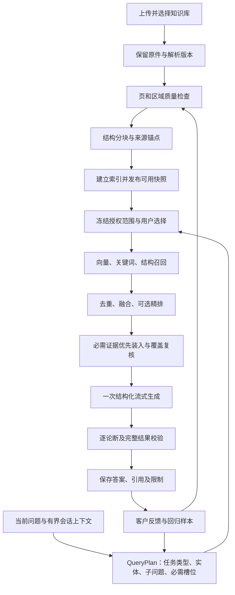

# ragent 代码对比与 DocQA 提升方案

版本：讨论方案 v1.0；2026-10-23。本文是下一阶段设计，不表示下述能力已经实施。

本轮只阅读代码、核对历史证据并编写方案，没有修改业务代码、迁移正式数据库或调用生成／向量供应商。已实施的上一轮改动另见 [RAG链路升级方案](RAG链路升级方案.md)，产品既有排期见 [下一阶段优化计划书](下一阶段优化计划书.md)。

## 1. 对比结论与依据

建议保留 DocQA 的 Python、现有 Docling/GPU、版本化原文和严格引用校验，吸收 ragent 的问题处理、可插拔检索、精排、记忆及流量治理设计。优先解决“解析质量不透明、复杂问题证据覆盖不足、正确归纳被误拦截”，随后完成反馈和运行保障。

ragent 的工程组织更完整，不能据此认定它对这些论文的答案准确率更高。DocQA 已有的逐论断原文范围、数字限定、不可变来源和请求预扣，也不能用 ragent 的文档角标或整批证据闸门替换。两者没有在同一冻结语料和问题集上运行，本次不提供胜率或性能倍数。

- **ragent 基线**：本轮查询 GitHub 的 main，提交为 `ff93871ab88fff24a5dac7feee7ea342359a3439`，与上一轮参考版本相同。递归目录树包含 2023 个条目、未截断；目录条目数不等于已通读文件数。仓库是 Apache-2.0。
- **阅读范围**：重点阅读 RAG 的问题重写、意图、记忆、检索处理器、入库、解析路由、来源装配、模型路由、排队及反馈实现；源码索引见第 10 节。不是对全部 Agent、前端、第三方依赖的完整安全审计，也未部署或运行 ragent。
- **DocQA 基线**：`main` 的 HEAD 为 `6acfb9e83235f59b72aa1cad91b84cb8e6c0b49f`，同时包含现有未提交升级，比较对象是当前工作区，不能只拿 HEAD 比较。数据库 schema14、56 张表。
- **既有验证**：上一轮单次全量 1619 项、10 组网页与 18 项检查通过。职教论文已有同一真实响应的零 HTTP 重验结果：17 条论断、13 条引用、5 条推断；这不是规则修复后重新向模型生成一次，更不是泛化准确率。发布及页面验收见本机 `data/rag-upgrade-release-20261023/verification.json`。
- **本轮网络情况**：取得提交及目录树后，本机直接下载原始代码出现 DNS 失败，已停止该下载；新增模块改用网页读取固定提交的实际源代码，既有检索模块同时对照本地缓存。不把空下载文件计为已读源码。

## 2. 能力对照

| 链路 | ragent 核对到的实现 | DocQA 当前实现 | 取舍及改进 |
| --- | --- | --- | --- |
| 问答编排 | `StreamChatPipeline`：记忆→改写拆分→意图→歧义引导→检索→生成 [R01] | 统一客户入口，`KnowledgeWorker` 调度；历史 `RagService`／`QuestionWorker` 保留兼容路径 | 共用 QueryPlan、检索和校验接口，历史任务按原协议读取，避免两套策略继续分化 |
| 问题理解 | `MultiQuestionRewriteService` 结合词语映射、历史和可开关的 LLM 改写，失败保留归一化问题 [R02] | 标点拆分、有限方面词和证据槽位；会话问题串接作为检索提示 | 增加可追溯的任务类型、实体、指代、子问题和必需证据规划；保留原问题 |
| 意图识别 | `DefaultIntentClassifier` 对叶子候选做模型打分，`IntentResolver` 聚合子问题意图 [R03] | `intent-rules-v2`：完整示例、纯交互模式、库内关键词；歧义回到检索 | 先区分业务意图和问答策略；语义候选可选，不给每条子问题额外调用分类模型 |
| 检索范围 | `RetrievalScopeResolver` 为通道统一决定目标库、补充库；部分失败可回到有效库全局 [R04] | 提问时冻结获授权的知识库快照和文档，执行及事件读取重验权限 | 借鉴统一 Scope 对象；实际范围始终是授权、选择、快照的交集，不复制全局扩大范围的回退 |
| 混合召回 | 可启用向量、ES 关键词、图谱、联网通道；并行执行、设置超时 [R05] | 已有向量、Python BM25、标题／定义／数值锚点及邻接扩展 | 保留现有通道，抽出统一 ChannelResult；先提升现有通道质量和统计，图谱、联网另作实验 |
| 融合与精排 | 按原通道名次做加权 RRF，控制精排池，再由可开关的 reranker 排序 [R06] | 已有确定性融合和覆盖排序；没有真正的语义精排模型 | 新增可选精排接口，先离线回放比较；分数不解释为正确概率，不直接跨模型套阈值 |
| 证据闸门 | `EvidenceGatePostProcessor` 读取整批最高精排分；过线后弱项也可能保留，无分时放行 [R07] | 原文范围、数值／单位、来源边界和逐论断校验；槽位是检索线索 | 组合“检索相关性＋必需槽位＋逐论断支持”，不以整批最高分认证整份答案 |
| 上下文预算 | `RetrievalBudget` 分离召回、候选池、最终 TopK [R08] | 已有四项预算、题型配置、抽取压缩和跨页绑定；最终跨文档装入仍可完善 | 统一配置、保留全局槽位覆盖，先保必需证据，再补案例；精确核算整个请求 |
| 会话记忆 | 最近消息加持久摘要；跨过窗口边界后异步压缩，并有并发保护 [R09] | 最多 3 条成功的用户问题、800 字主动条件；旧答案不作为证据 | 增加显式实体和来源轮次，再加可开关摘要；记忆仍是理解线索，不能作事实引用 |
| 解析与分块 | MIME×档位注册、启动自检；PDF 等走 MinerU，分块与增强为节点 [R10] | Docling/OCR、坏字库转图像、同坐标数字恢复、结构分块、新旧版本共存 | 学习档位和质量路由，保留现有部署；数学解析器只在隔离样本上对比，结果达标才接入 |
| 元数据增强 | `EnricherNode` 可为块调用模型补关键词、摘要、元数据 [R11] | 原始块、表格、章节、坐标及质量告警已保留；缺少通用语义标签 | 先从真实结构提取标签；模型标签保存为派生数据，只帮助召回，不能冒充作者结论 |
| 引用呈现 | 所核对 Workflow 统一请求内文档编号、SSE 和来源面板 [R12] | 稳定 evidence ID、解析版本、quote、连续范围和真实坐标 | 保留 DocQA 细粒度引用；完善印刷页号和公式定位，不退化成只有文档角标 |
| 模型与服务保护 | 模型候选、首包探测、健康状态、降级；Redis 公平排队及许可 [R13] | 固定供应商适配器、持久任务、租约、逐请求预扣、不确定调用不重发 | 先做用户／全局并发配额和熔断；任何新增上游尝试须单独入账，不透明自动切换不可照搬 |
| 反馈与质量闭环 | 消息点赞／点踩、原因、评论和持久反馈处理 [R14] | 有失败链路与离线 CI；缺少客户反馈到回归样本的工作流 | 建反馈工单、根因归类、经审核的回归样本及关闭条件 |

“可启用”表示存在对应接口和配置，不表示 ragent 默认开启全部组件。DocQA 的对照文件包括 [知识库执行器](../../app/knowledge_worker.py)、[检索管道](../../app/rag_pipeline.py)、[检索规划](../../app/retrieval_planning.py)、[原文装入](../../app/rag_context.py)、[意图路由](../../app/intent_routing.py)、[会话上下文](../../app/conversation_memory.py)、[知识库入库](../../app/ingestion.py)、[权限](../../app/product_access.py)及[引用协议](../../app/rag_answer_contract.py)。

## 3. 本次确认的具体差距

以下是代码观察及其设计影响，不把未复现的风险写成已发生事故。

### 3.1 知识库候选预算未完整使用统一配置

[knowledge_worker.py](../../app/knowledge_worker.py) 在 `answer()` 中构造 `RetrievalBudget(..., 32, context_k, budget)`；[config.py](../../app/config.py) 的 `question_candidate_k` 默认 64，历史单文档链路会使用它。管理员调整该配置，并不能等价调整知识库路径的这个候选上限。

**改进**：同一 QueryPlan 解析最终预算，各入口调用相同预算解析器；诊断记录“配置值、题型调整值、最终生效值”。更大的候选池不会自动扩大生成上下文或模型费用，新增精排后则须单独计算其成本。

### 3.2 每文档槽位不能直接代表最终装入覆盖

`build_evidence()` 会产生 `slot_hints`；`knowledge_context()` 在多个文档间轮流取候选，再新建总 `EvidencePack`，没有汇总各文档的槽位身份及最终覆盖提示，最后一次 `pack_evidence()` 也未传入槽位。当前每文档的槽位编号还可能相同，不能直接拼接。

**改进**：槽位归属于问题计划，来源归属于文档版本；先合并候选再分配全局必需槽位。记录召回为空、精排淘汰、质量排除、字符装不下等不同原因。预算后重新检查覆盖，必要槽位缺失时只明确回答可支持部分或要求澄清，不宣称全部完成。

### 3.3 概述题存在入口和词面边界

`_plan_retrieval_v1()` 的整文装入只接受特定概述词及全文容量条件；`budget_profile()` 的概述识别使用另一组词。日常的“这份文档讲了什么”不等同于显式“全文／概述”，不能保证走到相同策略。知识库即使碰巧装入较多内容，也不等于全文处理认证。

**改进**：由 QueryPlan 一次识别概述任务：可完整装入则明确记录覆盖；放不下则调用已有全文分析规划，显示范围、请求上界和未覆盖章节。通过现有摘要结果版本复用减少费用，不能用 TopK 结果宣称读完全文。

### 3.4 检索中的“重排”仍以规则为主

当前 `coverage_rerank` 是关键词、结构、相似度及覆盖约束的本地排序，不是交叉编码器或 rerank API。字段或节点名称不能充当语义精排已经完成的证据。

**改进**：增加可选 Reranker。先在标注候选上比较它与现有排序，查看必需证据有没有被排出。定义段、反例、公式和原文冲突两端可组成绑定组，不能因单片段分数低而丢失核对依据。

### 3.5 解析告警未形成问题级可用性判断

已有乱码拦截和内联恢复，但还有无法可靠归位的碎片和公式限制。某份文档总体可用，不代表其每个公式、数值和表格都可靠；反过来，局部公式不可用，也不应妨碍问答可靠的正文部分。

**改进**：按页／区域登记质量与能力。问题需要公式比较时，检查所需公式是否真正可读；不可靠就说明该项无法核对，并给原页入口。普通正文问题无需因无关页的公式告警全部失败。

### 3.6 当前可追踪错误，还不能自动形成质量闭环

[knowledge_traces.py](../../app/knowledge_traces.py) 已能展示阶段及失败论断，检索诊断在后台只投影总条数、字符数和舍弃数量。还缺少全局槽位覆盖、精排前后变化、Token／费用完整度、客户反馈和修复验收的联动。

**改进**：在保持后台正文隔离的前提下，逐步补充计数、阶段失败原因和基线对比。统计按解析／索引／问答、模型版本及时间窗口分组，区分排队与执行耗时，不能将混合任务的 P95 当成问答延迟。客户私有原文、问题和原始响应不因管理员查看链路而公开。

## 4. 建议的目标链路

QueryPlan 建议包含 `task_type`、原问题、检索改写、实体及其来源轮次、`subquestions`、`required_slots`、显式页／节要求、用户选择范围、预算、策略版本。任务计划和来源快照分别固定，模型不能自行扩大范围。改写只帮助找资料；问题中的数字、判断和假设仍须由真实原文核验。

## 5. 分阶段实施顺序与出口

| 阶段 | 优先级 | 具体交付 | 验收出口 |
| --- | --- | --- | --- |
| S0 基线与统一计划 | P0 | 冻结语料／失败样本；QueryPlan 契约；统一候选及输入预算；概述路由 | 相同输入得到可重放计划；正常页码不当业务数值；“讲了什么”正确识别任务，未全文覆盖不能称全文 |
| S1 解析与数学证据 | P0 | 页／区域质量报告、数字角色与来源绑定、页码映射、公式证据组 | 数字、单位、主体不串位；空公式不变成已核对；公式与相反正文同时可追溯，保留原文矛盾 |
| S2 检索与覆盖 | P0 | 全局证据槽位、统一通道结果、融合、可选精排、预算后覆盖复核 | 必需证据存活率提升；定义／例外／反例不被挤出；新排序对基线问题无关键退化 |
| S3 理解与记忆 | P1 | 分层意图、术语映射、按需模型规划、实体指代、可选摘要 | 闲聊零外调；混合业务不误走闲聊；长追问保留实体，记忆和摘要不能作为原文证据 |
| S4 生成与反馈 | P1 | 分层校验、可读回答、诊断归因、反馈工单及回归闭环 | 硬错误继续拦截；合理归纳不因分析词缺逐字匹配全部失败；客户能提交错误类型并追踪处理 |
| S5 运行与规模 | P1／按容量升级 | 用户／全局配额、排队／熔断、服务驻留、备份演练；索引性能优化 | 超载可控且无重复收费；异常退出不隐式重发；备份可恢复；按实测决定独立存储需求 |

按 S0→S1→S2→S3→S4→S5 推进，每阶段独立提交和验收；配额、故障监控等不依赖语义功能的部分可在同一阶段顺带完成。先完成 S0 的基线，不同时更换解析器、Embedding、生成模型和提示词，否则难以判断收益来自哪里。

### S1：把数字问题分成三条处理

1. **识别／归位问题**：检测坏字库、数字脱离正文、双栏交错、页眉页脚污染。只有来源和坐标足够支持时恢复；纯扫描页不能依赖缺失文字层猜测，保留需要复核的区域。
2. **类型问题**：统一描述物理页／印刷页、章节／命题／图表／式号、文献序号、列表序号、真实数值、时间和公式下标。保留原始字符及偏移；相同字面数字不意味着类型相同。不是继续堆积“删除页码数字”的正则。
3. **支持问题**：真实数值仍需主体、单位、期间、口径及条件；金额不能借图号证明，百分比不能借题干补入。不能因改进误拦截而放宽这些负例。

印刷页码通过可验证的 PDF 标签／页内信息映射，不能默认固定偏移。界面可显示“PDF 第 2 页／印刷第 19 页”，映射不可靠时只显示已知物理页。

数学证据建议形成“式号＋原始公式文本／可核对表示＋所在区域＋符号定义＋命题／推论＋相关正文”的绑定组。辨析题同时召回公式与正文；不一致时报告差异，不替作者改式子，也不由模型补全空公式。引入第二解析器只做隔离对比，先检验不等号、上下标、希腊字母和成本分担主体，不能只看识字率。

### S2：以证据槽位约束精排与预算

候选归并后，先为每个必需槽位选择最短充分原文；跨页续句、表头／脚注、公式／符号定义以组为单位装入。剩余预算再增加第二证据或案例细节。槽位被覆盖只表示有候选入选，不自动表示语义充分，人工标注和最终校验仍需检查。

普通事实题、多跳题、概念辨析题、概述题使用不同预算配置。现有默认候选 64、上下文 32 项、证据 24000 字符、整体输入 32000 字符只作为代码默认基线，正式环境值以实际冻结配置为准。先统一生效规则，再测量扩窗价值；不能把字符数直接称为 Token 窗口。

整个请求核算 system、问题、记忆、证据元数据、JSON 转义及输出预留。支持可靠分词时按对应模型核算，无法可靠分词时保留保守估计及“估计”标识。上下文变大、召回变多、证据更完整三者分别测试，防止费用上升却丢失重点。

### S3：让意图和会话真正改变执行

分开两个概念：业务意图决定知识域／已接入工具，任务类型决定事实检索、对比、概述、否定判断或结构辨析策略。论文问答不需要管理员为每个知识点手建意图节点；节点应实际关联资源、约束或模板，并能在测试台解释命中及回退。

优先使用零模型的确定规则和受控术语表；复杂追问再启用一次结构化规划，把指代解析、子问题和任务类型合并处理。规划失败保留原问题，不能改掉否定词、单位、比较对象或预设作者结论。语义打分只作候选排序，不是已校准的正确概率。

记忆先记录“用户正在比较谁、限制条件来自哪一轮、当前材料是哪份”。需要助手历史帮助消解“第二种机制”时，只将其作为带来源轮次的指代线索，再从当前授权原文重取事实。摘要包含覆盖轮次、记忆版本、用户更正及失效状态；关闭／清除记忆后，已排队计划和缓存也须重新核对。摘要生成若使用模型，必须有独立预扣，不因后台异步而免费或无限触发。

### S4：校验分层，不用“全部放行”修复误拦截

| 校验层 | 典型情况 | 处理原则 |
| --- | --- | --- |
| 来源／协议硬校验 | 未知引用、越界 quote、跨版本、错页、泄露范围 | 拒绝正式发布；保留失败位置和受控诊断 |
| 关键事实硬校验 | 数值／单位／主体冲突、明确否定相反、用户事实被当原文 | 相关事实不能发布；必需结论依赖它时整体未完成 |
| 支持复核 | 合法综合、结构性归纳、分析词不逐字出现 | 标记论断类型、证据和待复核理由；不能伪称自动语义认证 |
| 表达呈现 | 引用重复、条件拼接生硬、说明过长 | 用确定性渲染改善可读性，不删必要条件，不再调用一次模型润色改写事实 |

是否允许发布“部分回答”必须作为明确产品状态设计：说明已答／未答槽位、保留原失败状态及历史，不把前 16 条草稿改名为完整成功。现有完整结果发布和 SSE 断线恢复语义保持；局部合格不等于整体通过。

反馈类型建议为：数字／单位、页码／引用、遗漏内容、未回答、原文矛盾、表达问题。客户决定是否附上私有片段；管理员默认只见必要元数据。工单依次经过复现、根因分类、修复、原失败重验、独立负例、关闭；未经审核不自动写回知识库或训练数据。

### S5：学习运行机制，按当前规模落地

先在现有持久任务体系上增加每用户并发、全局并发、排队上限、等待超时和取消；单机阶段可用数据库原子领取及租约，不必先部署 Redis。被拒绝的请求不能偷偷调用标题生成、摘要或其他模型。模型熔断避免反复打故障上游；在途结果不确定时继续 needs_attention，不因“降级”自动再收费一次。

当前向量检索按文档加载向量、计算相似度，本地 BM25 也遍历块。先做固定索引版本的只读缓存／预构建词面索引和容量基准，再考虑 ANN 或独立向量库。缓存必须绑定用户范围、快照、解析／索引版本、模型和策略，撤权后不能命中旧缓存。不同模型的向量绝不能混检。

例如把 1 万／5 万／10 万块、1／5／10 个并发用户作为待测档位，记录硬件、索引大小、冷暖缓存、检索 P95、排队和内存。它们是实验规模，不是产品已支持容量。明确触及本机容量或多实例要求后，再评估 PostgreSQL/pgvector、对象存储、Redis；不是一次迁入 MySQL、Milvus、ES、RocketMQ、RustFS 全套。

产品既有的显示名称、用户旧密校验／两次新密、管理员固定初始密码重置及强制改密、独立用户／管理导航继续按原计划实施，不因本次 RAG 研究被取消。服务驻留、故障告警、备份恢复和临时数据清理也属于团队试点出口。

## 6. 数据库和兼容策略

本轮数据库保持 schema14。后续优先复用已有任务快照、检查点、调用账本和来源表，不为每个检索步骤建新表。

| 数据 | 建议承载方式 | 保护要求 |
| --- | --- | --- |
| QueryPlan、检索分值／归因、全局槽位、装入报告 | 有版本和哈希的任务输入／诊断检查点 | 旧任务仍按旧协议读取；不能编辑历史输入 |
| 解析区域质量及派生标签 | 与 parse_version 绑定的扩展记录；必要时新增质量报告表 | 原文与派生标签分开；新规则产出新版本 |
| 数字、公式、印刷页映射 | 来源扩展元数据或专用类型记录，保留原始偏移 | 不把未知页号补成确定值，不改旧引用身份 |
| 会话摘要／实体 | 版本化记忆记录，关联用户和消息范围 | 清除、到期、撤权及并发更新可验证 |
| 客户反馈与处理审计 | 消息反馈及审计增量表 | 对私聊和临时库按所有者隔离 |
| 用户／全局配额 | 配额、预留及结算增量记录，与现有调用关联 | 失败／不确定尝试仍计数，重试不重置累计账本 |

迁移号由实际实现确定，不提前宣称 schema15 或某张新表已经存在。正式迁移前做 SQLite 一致性备份，在独立副本演练升级、失败回滚和重复启动；验证旧原件、账号、会话、快照、来源和成功结果仍可读取。涉及外部索引时采用新旧索引并行及指针切换，不能先删除旧索引。

精排、模型规划和会话摘要分别设功能开关，初始关闭；同一任务保存开关及策略版本。先隔离验收，再限定用户／知识库试点，记录收益及退化后扩大范围。关闭新功能只影响新任务，历史结果继续按自身协议读取；权限与来源硬校验不提供绕过开关。

## 7. 如何证明有提升

### 7.1 数据集与对照

建议先整理 60 题，按文档划分开发、阈值校准和保留集，例如 24／12／24 题；原有反复修复的论文及变体只能进入开发集，同一文档不跨集合。覆盖普通论文、建模论文、扫描／双栏、表格和多格式；题型包含事实、多跳、否定、结构、公式冲突、概述、指代、无答案和权限边界。

每题标注最小支持范围、必需槽位、允许归纳、禁止结论和数值条件；冲突题必须标两端。没有相应数据就先标“待构建”，不得把计划 60 题当作现有已验收题量。测试原件不进公开仓库，CI 使用合成／许可样本。

固定解析、索引、模型、用户范围和原问题，一次比较一个变化：统一预算→全局槽位→精排→模型规划→新解析档位。模型输出相关指标还需独立人工审核；重验旧响应只证明该响应在新规则下的行为，不能代替新模型响应实验。

### 7.2 建议指标

| 指标 | 检查内容 | 建议验收目标，须在 S0 冻结 |
| --- | --- | --- |
| 数字／定位负例 | 页码冒充数值、单位或主体错配、文献序号串入 | 固定关键负例全部拦截；有效定位正例不能误伤 |
| 关键证据召回率 | 标注的必需支持范围是否进入候选 | 在固定 K 上目标不低于 95%，并单列无答案题 |
| 预算后证据覆盖 | 所需槽位证据最终是否被实际装入 | 目标不低于 95%；缺项必须解释，不能只看召回阶段 |
| 引用工程 | quote、版本、坐标及页码是否可核对 | 已发布引用工程校验全部通过；不将其称语义 100%正确 |
| 回答语义 | 核心点、否定边界、数字条件、冲突处理 | 人工 rubric 检查，优于冻结基线且无新增严重事实错误 |
| 误拦截 | 有充分原文的合格响应被拒绝 | 与基线相比下降；同时报告误放行，不只追求成功率 |
| 效率与费用 | 规划、召回、精排、首个合格块、总耗时及调用量 | 同硬件同负载比较中位数／P95和费用，避免只报最快一题 |
| 权限／恢复 | 撤权、范围变化、断线、重试、服务退出 | 所有固定隔离和不重复收费用例通过 |

95% 是建议目标，不是当前实测成绩。保留集规模小时还应列出分子／分母和每题失败，不能据少量通过外推通用能力。

### 7.3 CI 与真实验收分开

现有 [全量回归工作流](../../.github/workflows/rag-quality.yml) 在 push、PR 和手动触发时运行离线检查，不注入供应商密钥。继续加入类型化数字、全局槽位、语义精排接口桩、历史协议和故障恢复回归。按原样回放保存的输入／输出不发模型请求。

真实语义对比单独运行，锁定版本、题集和预算，保存首次失败；不在普通 PR 自动调用真实供应商。更换模型或新增检索接口前另做配置及成本验证，不能把测试桩分数当真实精排收益。

## 8. 调用成本设计

| 路径 | 供应商请求的设计上界示例 |
| --- | --- |
| 纯问候／感谢 | 0 次 |
| 普通知识库问答 | 通常 1 次查询向量＋1 次生成；不含建库索引 |
| 复杂题启用模型规划 | 在普通路径上最多加 1 次；不为每个子问题分别无限分类 |
| 远端语义精排 | 再加 1 次精排；本地模型则计硬件／时延，不等于没有成本 |
| 子问题向量 | 在供应商允许时批量请求；实际分批、失败及重试均分别入账 |
| 会话压缩 | 超过阈值且确实新增未压缩范围时才规划 1 次，并设独立上限 |
| 上传建库 | 原文分块向量按实际批次计费；增强标签若用模型须另列预算 |

这是设计示例，API 批量上限和返回协议必须在接入时验证。本次学习及编写新增供应商调用为 0；当前历史实验账本仍为 124/128，剩余 4 次，不能支撑整套真实 A/B 评估。本方案不重置账本或追加额度，也不把自动化 CI 当作免费真实模型验收。

## 9. 本轮建议采纳的范围

建议下一轮先交付 **S0＋S1 的质量诊断和类型契约＋S2 的全局槽位保全**，暂不更换生成模型或开启远端精排。先让每个失败都能明确归因为“源文不可读、缺证据、装入失败、数值冲突或校验误拦截”，再用冻结候选评估 reranker。

随后依次增加按需语义规划、实体记忆、反馈和容量治理。图谱、联网、自主 ReAct Agent、跨会话长期记忆、全套中间件及解析器整体替换保留为独立研究项；这些能力需要具体使用场景、可测收益和运行成本依据，不作为修复当前数字问题的前置条件。

## 10. 实际核对的 ragent 源码索引

以下链接固定同一提交，便于复核；本轮没有复制执行其中的 Java 代码。采用其代码而非仅借鉴思路时，应保留适用许可证和署名。

| 编号 | 实际源代码 | 主要核对点 |
| --- | --- | --- |
| R01 | [StreamChatPipeline](https://github.com/nageoffer/ragent/blob/ff93871ab88fff24a5dac7feee7ea342359a3439/rag/src/main/java/com/nageoffer/ai/ragent/rag/service/pipeline/StreamChatPipeline.java) | 编排顺序、澄清、系统回复、检索和流式 |
| R02 | [MultiQuestionRewriteService](https://github.com/nageoffer/ragent/blob/ff93871ab88fff24a5dac7feee7ea342359a3439/rag/src/main/java/com/nageoffer/ai/ragent/rag/core/rewrite/MultiQuestionRewriteService.java)、[QueryTermMappingUtil](https://github.com/nageoffer/ragent/blob/ff93871ab88fff24a5dac7feee7ea342359a3439/rag/src/main/java/com/nageoffer/ai/ragent/rag/core/rewrite/QueryTermMappingUtil.java) | 改写与规则回退、历史选择、术语映射 |
| R03 | [DefaultIntentClassifier](https://github.com/nageoffer/ragent/blob/ff93871ab88fff24a5dac7feee7ea342359a3439/rag/src/main/java/com/nageoffer/ai/ragent/rag/core/intent/DefaultIntentClassifier.java)、[IntentResolver](https://github.com/nageoffer/ragent/blob/ff93871ab88fff24a5dac7feee7ea342359a3439/rag/src/main/java/com/nageoffer/ai/ragent/rag/core/intent/IntentResolver.java) | 叶子分类、有效候选、子问题聚合及意图配额 |
| R04 | [RetrievalScopeResolver](https://github.com/nageoffer/ragent/blob/ff93871ab88fff24a5dac7feee7ea342359a3439/rag/src/main/java/com/nageoffer/ai/ragent/rag/core/retrieval/channel/RetrievalScopeResolver.java) | 作用域统一、无效库及重复意图处理 |
| R05 | [MultiChannelRetrievalEngine](https://github.com/nageoffer/ragent/blob/ff93871ab88fff24a5dac7feee7ea342359a3439/rag/src/main/java/com/nageoffer/ai/ragent/rag/core/retrieval/MultiChannelRetrievalEngine.java)、[KeywordSearchChannel](https://github.com/nageoffer/ragent/blob/ff93871ab88fff24a5dac7feee7ea342359a3439/rag/src/main/java/com/nageoffer/ai/ragent/rag/core/retrieval/channel/KeywordSearchChannel.java) | 通道并行、超时、主路与补充路隔离 |
| R06 | [FusionPostProcessor](https://github.com/nageoffer/ragent/blob/ff93871ab88fff24a5dac7feee7ea342359a3439/rag/src/main/java/com/nageoffer/ai/ragent/rag/core/retrieval/postprocessor/FusionPostProcessor.java)、[RerankPostProcessor](https://github.com/nageoffer/ragent/blob/ff93871ab88fff24a5dac7feee7ea342359a3439/rag/src/main/java/com/nageoffer/ai/ragent/rag/core/retrieval/postprocessor/RerankPostProcessor.java) | RRF、候选池、精排与通道存活归因 |
| R07 | [EvidenceGatePostProcessor](https://github.com/nageoffer/ragent/blob/ff93871ab88fff24a5dac7feee7ea342359a3439/rag/src/main/java/com/nageoffer/ai/ragent/rag/core/retrieval/postprocessor/EvidenceGatePostProcessor.java) | 批级最高分阈值、无分时放行及启动配置校验 |
| R08 | [RetrievalBudget](https://github.com/nageoffer/ragent/blob/ff93871ab88fff24a5dac7feee7ea342359a3439/rag/src/main/java/com/nageoffer/ai/ragent/rag/core/retrieval/RetrievalBudget.java)、[RetrievalEngine](https://github.com/nageoffer/ragent/blob/ff93871ab88fff24a5dac7feee7ea342359a3439/rag/src/main/java/com/nageoffer/ai/ragent/rag/core/retrieval/RetrievalEngine.java) | 三段预算和子问题检索 |
| R09 | [DefaultConversationMemoryService](https://github.com/nageoffer/ragent/blob/ff93871ab88fff24a5dac7feee7ea342359a3439/rag/src/main/java/com/nageoffer/ai/ragent/rag/core/memory/DefaultConversationMemoryService.java)、[JdbcConversationMemorySummaryService](https://github.com/nageoffer/ragent/blob/ff93871ab88fff24a5dac7feee7ea342359a3439/rag/src/main/java/com/nageoffer/ai/ragent/rag/core/memory/JdbcConversationMemorySummaryService.java) | 摘要和历史加载、窗口触发、并发压缩和持久化 |
| R10 | [ParserRegistry](https://github.com/nageoffer/ragent/blob/ff93871ab88fff24a5dac7feee7ea342359a3439/rag/src/main/java/com/nageoffer/ai/ragent/core/parser/registry/ParserRegistry.java)、[MinerUDocumentParser](https://github.com/nageoffer/ragent/blob/ff93871ab88fff24a5dac7feee7ea342359a3439/rag/src/main/java/com/nageoffer/ai/ragent/core/parser/mineru/MinerUDocumentParser.java)、[ChunkPacker](https://github.com/nageoffer/ragent/blob/ff93871ab88fff24a5dac7feee7ea342359a3439/rag/src/main/java/com/nageoffer/ai/ragent/core/chunk/blockaware/ChunkPacker.java)、[Provenance](https://github.com/nageoffer/ragent/blob/ff93871ab88fff24a5dac7feee7ea342359a3439/rag/src/main/java/com/nageoffer/ai/ragent/core/parser/model/Provenance.java) | 类型注册、解析档位、块打包和来源模型；不能据此宣称解决 DocQA 的数学解析 |
| R11 | [IngestionEngine](https://github.com/nageoffer/ragent/blob/ff93871ab88fff24a5dac7feee7ea342359a3439/rag/src/main/java/com/nageoffer/ai/ragent/ingestion/engine/IngestionEngine.java)、[EnricherNode](https://github.com/nageoffer/ragent/blob/ff93871ab88fff24a5dac7feee7ea342359a3439/rag/src/main/java/com/nageoffer/ai/ragent/ingestion/node/EnricherNode.java) | 节点链、循环校验、关键词／摘要／元数据派生 |
| R12 | [CitationContextEnricher](https://github.com/nageoffer/ragent/blob/ff93871ab88fff24a5dac7feee7ea342359a3439/rag/src/main/java/com/nageoffer/ai/ragent/rag/core/source/CitationContextEnricher.java)、[GroundingChunksAssembler](https://github.com/nageoffer/ragent/blob/ff93871ab88fff24a5dac7feee7ea342359a3439/rag/src/main/java/com/nageoffer/ai/ragent/rag/core/source/GroundingChunksAssembler.java)、[引用提示](https://github.com/nageoffer/ragent/blob/ff93871ab88fff24a5dac7feee7ea342359a3439/rag/src/main/resources/prompt/answer-citation-rules.st) | 请求内编号、文档级归并及引用格式；后者的 grounding 用于推荐问题，不是逐事实校验器 |
| R13 | [RoutingLLMService](https://github.com/nageoffer/ragent/blob/ff93871ab88fff24a5dac7feee7ea342359a3439/infra-ai/src/main/java/com/nageoffer/ai/ragent/infra/chat/RoutingLLMService.java)、[ChatQueueLimiter](https://github.com/nageoffer/ragent/blob/ff93871ab88fff24a5dac7feee7ea342359a3439/rag/src/main/java/com/nageoffer/ai/ragent/rag/service/ratelimit/ChatQueueLimiter.java)、[FairDistributedRateLimiter](https://github.com/nageoffer/ragent/blob/ff93871ab88fff24a5dac7feee7ea342359a3439/rag/src/main/java/com/nageoffer/ai/ragent/rag/service/ratelimit/FairDistributedRateLimiter.java) | 首包／健康／候选降级、公平队列、许可释放与取消 |
| R14 | [MessageFeedbackServiceImpl](https://github.com/nageoffer/ragent/blob/ff93871ab88fff24a5dac7feee7ea342359a3439/rag/src/main/java/com/nageoffer/ai/ragent/rag/service/impl/MessageFeedbackServiceImpl.java) | 消息归属、投票、原因、评论和异步反馈 |
