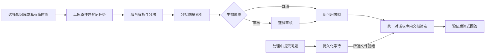

# DocQA 下一阶段优化计划书

> 本轮S2→S3→S4→S5隔离候选已完成四阶段代码、92项集成定向检查、稳定启停复测及合成浏览器检查；整包提交临时分支codex/rag-s2-s5-ci后运行GitHub全量CI，提交时CI结论待返回。尚未部署正式库。候选schema15／hybrid-context-v10／pipeline-v5，正式仍v60／schema14。范围、配置、迁移和未验证出口见[完整链路实施说明](../S2-S5完整链路实施说明.md)。本轮真实调用0，账本285/288；不将代码完成当作全部语义验收通过。

版本：执行版 v1.9 · 2026-10-24（按既有主线同步，不新开功能实施）
适用范围：小团队／企业内网，管理员维护知识库，多位客户使用并上传会话临时附件。  
初始基线：本地8000、schema11；B1与C1已交付。本轮用户采纳统一知识库流程，已部署schema14；正式数据与运行核验见接力说明及发布证据。
文档状态：用户已要求按计划推进，并明确知识库尚未发布不是当前主要问题。B1实用规则分流与测试台已交付；随后按用户“追加完成流式输出”优先交付C1真实流式。真实语义候选、多轮对象理解、反馈与运维出口继续保留，不因验收代用户发布资料。

## 当前首先推进：恢复ragent S2剩余检索工作（2026-10-24）

已部署代码为rag-task-v60／evidence-composition-v24／fact-context-parts-v8／validated-fact-stream-v2，schema14；按用户最新“语言逻辑要流畅”的口径试用发布。原12题6新版/5平局/1旧版，原9/12实验出口仍未通过，历史成绩不改写。对应源码6d9bbd5的GitHub全量1838项及所有离线关卡通过。唯一账本285/288、余3，当前未分配新的真实调用。

运行核对（2026-10-24 22:16，Asia/Shanghai）：Web、parse-worker、analysis-worker均已退出，当前8000服务未就绪；代码和schema仍匹配。19:55三个角色就绪是发布时快照，持续驻留故障未诊断。本次只读核对，没有重启服务。

当前RAG功能主线恢复ragent方案S2剩余项：统一通道候选契约与融合归因 → 冻结候选离线对照 → 按收益决定是否启用可选精排；随后才是S3问题理解/实体记忆、S4反馈、S5配额/容量。服务驻留是可独立处理的运维阻断，不据此重排已采纳的RAG依赖。

下一批先统一候选结果与通道命中／名次／原始分值／版本身份，建立融合与淘汰归因；固定候选及必要证据标注，对照候选阶段、精排后、实际预算装入三个层面的存活率。语义精排是可选组件，先做接口与离线桩及保存候选回放，收益和成本有依据后才考虑启用。全局槽位、定义／例外、公式冲突两端与跨页绑定已经实现，必须保留。详见[ragent方案第9.5节](ragent代码对比与提升方案.md)。

以下产品阶段A～D及较早“下一步”保留当时背景；B2对应当前S3理解与记忆，不越过本轮S2。

## 语言逻辑第二轮（2026-10-23历史检查点）

第二轮已实现完整句选材、段落规划、分题型写作及预算／检查点恢复，v44隔离源在`data/rag-language-round2-20261023/source/`。最新追加40次后当前196／248、余52；短事实和多跳有局部改善，过程比较仍因计划对象错配及联合依据未过校准，概念新限制尚未复验。下一步先修计划与原文阶段绑定，不能通过放宽比较校验凑通过；校准后才进入原12题与相同rubric验收。详见[语言专项第12节](RAG语言组织与逻辑增强方案.md#12-续作校准与再次追加额度)。

## 本轮界面修复与下一项讨论（2026-10-22）

用户要求先修复三项：引用按钮过大且相连、资料筛选无法勾选、长会话标题默认折叠；第四项只排期讨论，不在本轮实施。前三项使用隔离预览与离线回归验证后更新本地实例，数据库保持schema14，不调用收费模型。

随后补正资料全选语义：原先空筛选表示全库，但复选框均未勾选，且用户取消最后一项也回到全库。现全库模式勾选所有已就绪资料并显示数量；未就绪资料只在显式选择时等待处理。用户取消全部勾选后显示“未选择资料”并禁止发送，刷新保持空选；无可用资料时禁用全选。9组网页检查和隔离浏览器验证通过，无供应商调用；正式更新核验见`data/scope-selection-release-20261022/verification.json`。第四项账号与双端仍只排期。

第四项列入下一阶段讨论：

- 用户个人设置支持修改显示名称；登录账号是否允许更改另行确定。
- 用户修改密码必须验证旧密码、新密码输入两遍且一致，新旧密码不得相同；沿用已采纳的4～32位范围。
- 管理员取消任意设置用户密码的操作，只能重置为用户指定的初始密码`123456`；建议同时设置首次登录必须修改密码、失效旧会话并记录重置审计，具体流程讨论后实施。
- 用户已选择同一服务、独立用户端与管理端：共用账号、后端和数据库，分别提供入口、界面、导航及权限。用户端保留知识问答、会话、授权资料与个人设置；管理端提供知识库、用户、意图、链路追踪及系统设置。普通用户不能通过直接请求后台接口绕过权限，管理员进入用户端问答时仍遵守会话与资料归属。

2026-10-22双端形态已由用户确认；本轮只更新设计，不实现第四项。建议具体流程如下，待讨论后实施：

1. 个人设置分为头像、显示名称、账号安全；先允许修改显示名称，登录账号保持稳定，避免与历史归属和成员授权混淆。
2. 用户改密依次填写旧密码、新密码、确认新密码。后端验证旧密、新密长度4～32位、两次一致且不同于旧密，成功后退出现有会话并用新密码重新登录；失败时不修改密码。
3. 管理员在用户管理只提供“重置初始密码”操作，服务端固定重置为`123456`，接口不接受任意新密码。建议失效目标账号全部登录会话，用户下次登录只进入改密页，完成后再使用问答或管理功能；审计记录操作者、目标账号、时间和结果，不记录密码。
4. 推荐按个人设置与用户改密 → 管理员重置及强制改密 → 双端导航与接口权限验收的顺序交付。数据库如需新增强制改密状态及审计记录，先完成迁移演练和备份，再更新正式实例；已有头像、会话、知识库授权和来源记录须保留。

本节仅确认排期及用户提出的规则，不表示昵称、改密、固定初始密码重置或双端改造已实现。

## 1. 下一步结论

用户后续采纳的统一流程优先于下方历史排期：**所有新问答基于知识库，所有新上传选择知识库，一个对话框和历史列表**。单文档只是库内筛选；管理员可写团队库，客户可使用私有临时库。上传自动完成持久化解析、分块、向量索引及生效，上传本身不生成答案；处理中的问题保存为等待请求，就绪后提交一次。默认逐份自动生效，也可选择管理员审核，其他草稿／失败文件不阻塞可用版。显式替换成功后才切换，旧原件和快照保留引用。

统一接口为`/api/chat/`、`/api/ingestions`，普通用户从`/app`使用；旧页面跳转统一入口，原记录经适配读取而非复制或重新生成。每轮固定记忆、实际文档范围和快照；切库新建会话，撤权／到期／取消在后续执行和SSE逐事件重验。

本轮实现与验收记录在原产品计划第23节；本地8000已升级schema14，旧数据及引用保留。全量1417项通过，后续29项定向和8组网页检查通过；真实TXT完整链路3次HTTP，累计102/128。未完成的语义候选、反馈、全局配额及运维出口继续保留。续作再次发现三个角色退出，恢复就绪不代表驻留问题已解决；该句原为2026-10-22产品阶段排期。当前服务驻留独立处理，RAG主线先恢复S2，再进入B2／S3多轮对象理解。

总体业务闭环仍为：**管理员准备并发布知识库 → 授权客户 → 客户提问和追问 → 查看原文 → 反馈问题 → 管理员处理**。知识库草稿是正常配置状态，只会影响该库的客户可用性，不能仅凭发布版为0判定工程故障。

B1意图规则执行／测试台和C1真实流式已交付；概览／多轮对象理解、反馈和运维验收保留后续任务，当前执行顺序以上方S2主线为准。发布、授权的必要检查继续保留，RAG质量回归贯穿各阶段。

当前定位是**已部署的本地团队试用版**。已经能使用和已经通过完整生产验收，是两个不同的交付状态；真实流式C1已实现并完成一次实际网关验证；真实业务MCP、结构化对象记忆、反馈配额、团队容量及完整运维出口尚未完成。

## 2. 当前状态与缺口

以下数据库数量为2026-10-22正式v13库只读核查的快照，后续操作可能改变数量；不以旧ready记录推断当前进程。

| 领域 | 已有能力／实测状态 | 下一步缺口 |
| --- | --- | --- |
| 工作台与后台 | 蓝白界面、客户与管理端分区、可收缩侧栏、多行输入、头像、可展开引用与说明 | 收敛文档对话和知识库对话的使用入口，统一状态与组件，补连续流程和窄屏验收 |
| 账号与权限 | 登录、管理员／客户、知识库授权、会话归属、CSRF及旧接口授权检查 | 对新增事件、反馈、配额继续落实同一权限；形成完整试点验收 |
| 知识库 | 建库、上传、解析／分块、边界修订、异步索引、发布快照、成员授权 | 当前有1个知识库、0个发布版；先验收从建库到客户可问答的真实流程 |
| 文档与索引 | 8份文档、7个解析版本、6个索引记录 | 索引记录数不等于所有文档当前均可问答；明确每份资料的准备状态和下一步动作 |
| 会话 | 1个文档会话、0个库级会话；持久化历史、开关／清除记忆 | 指代、比较对象、范围条件的理解；库级会话真实使用验收 |
| 意图 | 已交付B1：树／列表／测试台、完整示例／限定纯交互／库内关键词分流、配置指纹及实际路由追踪；60条固定规则通过 | 语义候选与会话对象理解尚未实现，规则集成绩不代表通用语义准确率 |
| 生成 | C1已实现真实`stream=True`、完整论断局部校验、事件落盘与SSE游标重放；旧同步接口保持`stream=False` | 仍需等待当前模型开始正文；更广资料质量、多轮理解与容量出口后续完成 |
| RAG | 稳定来源、逐论断引用工程、证据槽位、抽取压缩、库内多文档检索等已实施 | 新功能的真实质量回归、资料概览、多轮指代、跨文档冲突与反馈闭环 |
| 运维与存储 | SQLite、原件本地保存、三个角色、任务租约／检查点、逐调用账本、受控备份迁移 | 三个角色异常退出／持续驻留、用户／全局配额、持续监控、备份恢复演练、容量及运行维护出口 |
| MCP | 只读适配器及协议模拟 | 尚无接通并验收的真实业务源；有接口、权限和样本后再交付具体场景 |

已有工程测试和合成供应商测试不作为真实模型语义成绩。已有三道论文题继续保留，不能用新题替换失败题。

## 3. 原产品阶段划分（当前执行顺序以顶部为准）

| 阶段 | 优先级 | 主要交付 | 完成标志 |
| --- | --- | --- | --- |
| A：业务闭环与发布基线 | P0 | 真实知识库可使用、处理状态清楚、代码与数据库版本可追踪、预览环境隔离 | 客户能完成提问／查看来源；失败、撤权、刷新均有正确行为 |
| B：实用意图、多轮理解与入口收敛 | P0 | 意图测试台、混合输入分流、概览／细节／比较等问题规划、可解释会话状态 | 同义问法能处理，业务问题不被问候／感谢截走，追问对象和资料范围正确 |
| C：真实流式与任务恢复 | P1 | 模型流适配、校验块展示、持久化事件、重连和取消 | 上游结束前出现有效正文块；刷新／重连不新建生成请求 |
| D：质量反馈、用量和试点运维 | P1 | 反馈处理、质量看板、配额、备份恢复及容量验收 | 有范围明确的内网试点交付和可复核的运行记录 |

按阶段交付，不把四阶段合成一次大改。用户已调整优先级：B1先行，A中的隔离、版本、迁移和恢复保护同步实施；真实知识库业务验收在管理员实际准备资料后继续，不把草稿状态作为其他优化的阻塞。

## 4. 阶段A：先让真实业务走通

### 4.1 知识库准备与客户可用性

1. 使用隔离样本跑通建库、上传、解析、分块预览、索引、发布与授权，再用已确定的正式资料核对管理员流程。
2. 文档展示明确阶段：已上传、处理中、待检查、待索引、可发布、已发布、失败。后台提供与状态对应的操作，客户只看到有权使用的发布版。
3. 明确“资料在收件箱”“资料属于知识库”“资料已发布且获授权”的差异，避免文件上传成功后客户仍不知道为什么不能提问。
4. 资料更新时保留旧发布快照；新处理失败不替换旧版。会话显示实际资料范围和版本，禁止静默切换证据范围。
5. 失败提示提供下一步操作和支持编号；管理员从该编号进入任务或链路记录，客户页面不展示内部调试信息。

### 4.2 开发与发布基线

- 整理当前未提交代码、测试、数据库迁移与发布清单，形成可审阅版本；密钥、原件、数据库及私有截图继续排除在Git之外。
- 预览使用独立数据目录、独立主机名及明确的测试Cookie边界，自动检查测试登录不会覆盖正式站点登录。
- 统一版本标识、迁移说明和回退材料。新增功能先在隔离库验证；正式升级前做一致性备份副本演练。

**阶段A验收：** 至少完成一个知识库的全流程、一个需两份文档共同支持的问题、一次客户授权／撤权、一次文档更新失败；验证未授权资料不进入候选，刷新／重复点击不增加收费提交，旧回答与来源仍可读。

## 5. 阶段B：让意图和会话真正影响结果

### 5.1 意图识别的作用

意图需要决定实际执行路径：是否检索、检索哪个授权范围、采用什么证据规划、是否需要澄清，以及是否允许调用已接入工具。单纯增加节点、关键词或提示词不能算完成。

| 输入情况 | 期望行为 |
| --- | --- |
| “你好”“谢谢”一类纯交互 | 明确命中后给出自然短回复，不访问向量或生成供应商 |
| “你好，退款多久到账” | 保留退款问题，进入知识检索 |
| “这份文档讲了什么” | 进入文档概览规划，覆盖主题、结构、结论与限制，引用仍定位原文 |
| “它和前一个案例有什么区别” | 从本会话状态确定比较对象；无法确定时澄清 |
| 多个意图接近、范围不明 | 在当前授权范围内回退知识问答，或提出具体澄清；不擅自扩大资料范围 |
| 实时业务数据请求 | 仅进入已启用且已授权的真实工具；未接入时明确说明缺少对应数据源 |

建议采用“确定性纯交互 → 语义候选 → 置信门槛／歧义处理 → 授权执行”的分层路径。分类质量不足时再评估受限模型兜底，不默认给每条消息增加一次模型请求。

语义候选使用版本化示例和缓存；可兼容时复用查询向量，避免分类和检索重复向量化。相似度不直接包装为可信概率。新增向量、改写或分类请求都纳入调用账本。

### 5.2 后台增加“意图测试台”

输入测试问题后展示命中节点、候选及匹配分数、回退原因、最终执行路径、配置版本和链路编号。管理员修改后可立即运行同一组样例做前后对比；默认测试配置，不触发真实业务工具或收费生成，执行级测试单独明确。

B1已有60条固定规则用例；后续语义候选应另建未见表达、混合输入、否定反馈、追问和歧义的人工标注验证集，不把已知规则回归视为泛化。建议目标为规定测试集整体路由准确率不低于95%；混合业务被误判为纯闲聊、越权路由及未配置工具被执行，在必测对抗集中须为0。以上均为目标，不是当前成绩。

### 5.3 会话理解与统一入口

- 保存有界的当前对象、比较对象、资料范围、用户确认条件和未完成子问题，允许用户查看、修正和清除。
- 记忆服务于检索与问题理解；历史回答、会话摘要和用户前提均不能成为原文证据。
- 关闭记忆后不带入旧轮次；新会话、切换账号和范围变化不能串资料。
- 客户主入口逐步收敛到`/app`，新建时选择获授权知识库或会话附件；文档与库级会话保留明确范围标识。
- 先以会话服务适配层统一操作与显示，保留既有ID、请求键和历史链接。暂不强行合并现有任务表，也不为统一入口重写全部前端。

**阶段B验收：** 路由测试集前后对比、实际执行路径一致、会话指代／比较／条件保留测试、混合输入抗误分、关闭记忆与跨账号隔离；原有三道论文题及历史读取保持兼容。

## 6. 阶段C：真实流式生成

C1当前已实现，以下清单为保留的验收标准；实际范围和时序证据见第12节、阶段04／05。尚未完成稳定延迟及容量出口。

目标链路：**一次生成请求 → worker接收模型增量 → 形成完整内容块 → 局部校验 → 持久化事件 → 客户端展示 → 最终整体复验与保存**。

1. 先验证当前实际网关、模型及参数的流式兼容性，不因供应商接口宣称支持就认为项目已经兼容。
2. 优先采用块级真实流式。必要时新增版本化输出契约，让事实、引用及条件能够组成可独立检查的完整块；保留旧结果协议兼容。
3. 不展示模型思考或半截JSON。生成中的块保持“生成中”状态；局部通过不标为整份答案已经完成验证。
4. 最终检查结束原因、覆盖、引用和块间一致性；通过后才标记完成并开放正式导出。失败或截断明确显示未完成，不伪装成功。
5. 内容事件绑定用户、任务、轮次和单调序号，先持久化后发送。SSE订阅与重连只读取已有任务，不触发新模型调用。
6. 撤权、账号停用和会话失效时停止继续输出。刷新后按游标重放并去重，最终数据库结果为权威版本。
7. 上游中断或worker重启，缺少可靠检查点时保留中断状态，不自动重发；停止展示不等于上游立刻停止计费。

**阶段C验收：** 有上游结束前出现正文块的时间证据；覆盖中途断网、刷新、重复订阅、主动停止、撤权、worker重启、截断与引用失败。每次模型请求均能与任务和账本对应。

首个阶段提示目标为本地环境1秒以内；首个有效回答块和最终完成时间记录实际值并与基线比较，不预先承诺模型首字延迟。不用少量在线样本宣称稳定P95成绩。

## 7. RAG质量：贯穿迭代的四条改进线

| 方向 | 具体改进 | 验收依据 |
| --- | --- | --- |
| 概览与问题规划 | 区分概览、细节、多跳、否定、结构辨析及追问；概览覆盖全文结构而非只看高分片段 | 主题、核心结论和重要限制不遗漏；资料覆盖不足时明确范围 |
| 检索与证据预算 | 先覆盖必要证据槽位，再增加补充材料；定义优先、抽取压缩、跨页去重，记录未装入原因 | 必需槽位覆盖、直接定义命中、上下文占用和引用可定位性 |
| 生成与引用 | 保留事实条件、例外与冲突；区分原文直述和结构推断；自然表达但不删除引用 | 最小支持原文、稳定来源ID、页码／坐标、条件保留；形式通过与语义复核分开 |
| 质量闭环 | 保留三道论文题，补充跨文档冲突、扫描资料、多轮指代和无依据问题；记录首次失败 | 固定输入与版本的前后对照，失败分类，用户反馈转为回归案例 |

保留原文严格校验规则，不通过模糊清洗引文、改参考答案或删失败题提高成绩。三道题仅代表该文档和规定题型，不能推导出所有文档均可靠。

增大上下文、增加TopK、重排或模型改写，均先比较必要证据覆盖、实际token、延迟与质量。字符上限、模型token窗口、输出额度和调用费用分别统计，不统一称作“预算不足”。

## 8. 阶段D：生产级产品所需的运行闭环

### 8.1 反馈与质量看板

客户可针对具体回答标记不准确、来源不符、信息缺失或有帮助，并选择是否提交问题和必要上下文。后台提供待处理、复现中、已修复和已关闭状态；记录关联版本、修复结果与回归案例。

管理员按授权读取反馈材料，不因链路诊断默认获得全部客户私聊。看板区分回答成功率、引用工程通过率、人工语义复核结果及用户反馈，避免一个绿色分数掩盖不同问题。

### 8.2 配额与并发

复用现有逐任务预算与原子预扣，增加用户／全局任务数、活动生成数、上传容量、存储容量及日用量限制。单会话活动任务限制、排队、重试与幂等规则继续保留；所有新入口都遵守同一限制。

后台分别显示调用次数、已知token、上下文占用及可核实费用；未知用量保持未知。网络重连不增加生成，失败与不确定调用保留消耗记录。

### 8.3 运维与试点

- 统一监控排队、解析／索引失败、首块与总耗时、供应商错误、worker状态、磁盘与备份结果。
- 完成包含原件、数据库、索引及头像的独立恢复演练，核对旧回答、来源与授权；配置和密钥单独受控保存。
- 验证服务重启、日志轮转、附件过期清理和异常任务恢复，不自动重发不确定的收费请求。
- 内网团队部署检查实际访问地址、HTTPS／Cookie配置、稳定进程启动及维护说明。
- 先验证10个并发读取与2个活动生成的目标场景（离线桩用于工程压测），再据实确定并发上限；首批建议3～5名试用者，不将此人数当作已测容量。

**阶段D验收：** 反馈可追踪到处理结果，用户／全局配额不可绕过，备份实际恢复成功，规定并发场景无跨用户污染、重复生成或数据库锁错误；交付管理员和客户说明。

## 9. 数据库与架构演进

schema12持久化意图策略，schema13增加answer_stream_events，分别外键绑定文档／库级任务。schema14增加库类型、生效策略／期限、会话设置、私有历史范围投影、旧记录桥接、入库任务／请求键、临时库键及等待请求；不重建旧原文／索引，不将旧资料发布给团队。后续反馈、操作审计、用户用量及配额按需要新增迁移。

SQLite短期保留，先测写入竞争、事件数量、文件容量及备份恢复时间。若需要多机worker、更高写并发或独立数据库服务，再安排PostgreSQL迁移演练。对象存储、专用向量库和Redis同样以实际容量、部署与查询需求为依据，不一起更换所有基础组件。

每次迁移都在正式一致性备份副本演练，检查旧数据、外键、来源和导出，再受控切换。回退前保全升级后新增数据，不能用旧备份覆盖新会话或头像。

## 10. 验证与调用预算

当前为285/288、余3；下列102/128及19次分配是2026-10-22历史方案，不是当前可执行额度。本次同步与S2准备先为0供应商调用，新的真实阶段另冻结输入与上限；不能沿用旧表获得调用许可。

继续沿用既有唯一累计验收账本，B1交付时97/128，C1新增2次至99/128，本轮统一链路新增3次至102/128，余26次。未换账本、扩总额或自动重试。日常客户用量管理与工程验收用途分别记录。

扣除本轮已使用的3次后，下一轮建议最多使用19次在线验收请求，保留至少7次余量；这是建议分配，不是已执行请求，成功链路不默认重复收费。

| 用途 | 建议请求上限 |
| --- | ---: |
| 建库发布与真实问答闭环的必要补验 | 1 |
| 意图／多轮理解的必要真实验证 | 6 |
| 流式变更后的必要复验（C1已验证，不默认重复） | 4 |
| 三道论文题必要回归 | 6 |
| 新增示例向量或必要索引 | 2 |
| 合计 | 19 |

每阶段执行前冻结样本、配置和请求上限，能复用原解析、索引及合法缓存就复用。分类、索引、生成、失败和重试按实际供应商HTTP计数；超过分项上限时先调整测试范围或重排分配，不自动追加调用。大量路由、权限、事件重放、并发与恶意输入场景先使用离线测试。

## 11. 交付标准与暂缓事项

完成A～D及下列条件后，交付范围明确的内网小团队试点版本：

- 管理员建库、发布授权和客户完整使用路径有新证据。
- 实用意图、记忆与真实流式均有独立验收，未完成答案不冒充成功。
- 新入口权限通过，历史数据、来源和导出保持兼容，重复提交及重连不重复生成。
- 固定RAG集和新增场景有前后对照，已知限制明确记录。
- 反馈、配额、备份恢复、运行说明、发布版本及回退材料齐全。

真实业务MCP需先选一个具备接口、授权和样本的场景；公网SaaS、多租户、商业计费、企业单点登录、跨会话长期记忆及大规模前端重写暂缓。现阶段优先把实际使用和维护流程做完整。

## 12. 下一轮首先交付什么

B1已交付：文档／知识库共用受控规则分流器、管理员测试台、混合输入与歧义回退、真实执行路由追踪，以及配置和历史兼容。当前60条固定规则用例通过，不是通用语义理解准确率；问候不进入后续业务记忆。测试台支持同页配置切换后的前后结果对比，不持久化客户测试问题。

用户随后要求追加完成流式输出，C1已先行：原事实协议不变，在上游仍输出时校验完整论断、保存局部事件再展示，全部复验后保存正式结果；三个对话入口接入SSE，刷新／重连不生成。88项关联工程与七组网页检查通过。真实单题新增2次HTTP成功，首个有效块约41.95秒，上游结束约43.33秒，6块；这说明真实流式生效，不代表模型首块足够快或普遍性能成绩。

当前下一增量是S2统一通道候选契约、融合归因及冻结候选对照，可选精排按收益决定；原B2的有界会话对象、条件和追问理解对应随后S3。现已部署的回答选材／段落规划不等同于B2的问题理解／实体指代规划。A的真实资料发布授权闭环、D的反馈、配额与容量出口保留。C1没有实现语义候选或自动消除模型思考耗时，不能将B1＋C1视为完整生产验收。

依据：[产品化原计划与历史进度](产品化升级计划书.md)、[接力说明](../稳定试用版接力说明.md)、`app/intent_management.py`、`app/knowledge_questions.py`、`app/conversation_memory.py`、`app/deepseek.py`及正式`data/streaming-release-20261022/verification.json`及本轮`data/docs-runtime-audit-20261022/verification.json`。本计划的目标值、阶段和拟新增功能均不得作为已完成验收成绩。
