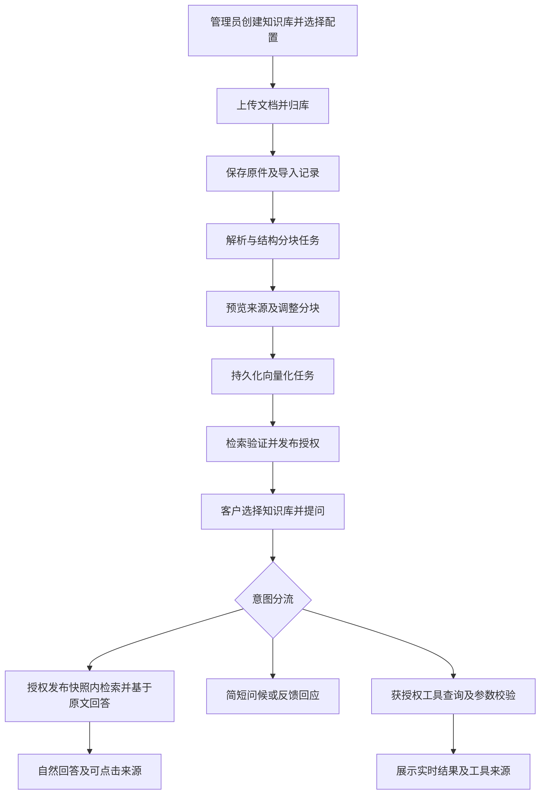

# DocQA 产品化升级计划书

> 本轮S2→S3→S4→S5隔离候选已完成四阶段代码、92项集成定向检查、稳定启停复测及合成浏览器检查；整包提交临时分支codex/rag-s2-s5-ci后运行GitHub全量CI，提交时CI结论待返回。尚未部署正式库。候选schema15／hybrid-context-v10／pipeline-v5，正式仍v60／schema14。范围、配置、迁移和未验证出口见[完整链路实施说明](../S2-S5完整链路实施说明.md)。本轮真实调用0，账本285/288；不将代码完成当作全部语义验收通过。

## 当前执行衔接（2026-10-24）

已部署代码为rag-task-v60／evidence-composition-v24／fact-context-parts-v8／validated-fact-stream-v2，schema14；按用户最新“语言逻辑要流畅”的口径试用发布。原12题6新版/5平局/1旧版，原9/12实验出口仍未通过，历史成绩不改写。对应源码6d9bbd5的GitHub全量1838项及所有离线关卡通过。唯一账本285/288、余3，当前未分配新的真实调用。

运行核对（2026-10-24 22:16，Asia/Shanghai）：Web、parse-worker、analysis-worker均已退出，当前8000服务未就绪；代码和schema仍匹配。19:55三个角色就绪是发布时快照，持续驻留故障未诊断。本次只读核对，没有重启服务。

当前RAG功能主线恢复ragent方案S2剩余项：统一通道候选契约与融合归因 → 冻结候选离线对照 → 按收益决定是否启用可选精排；随后才是S3问题理解/实体记忆、S4反馈、S5配额/容量。服务驻留是可独立处理的运维阻断，不据此重排已采纳的RAG依赖。

已有上传／知识库／规则意图／流式能力保持。账号显示名称、用户改密、管理员固定初始密码重置／强制改密及独立双端导航仍属已记录的产品待办，未由本轮语言更新实现。第1～23节原设计与历史排期不覆盖[ragent当前执行安排](ragent代码对比与提升方案.md)。

版本：原采纳方案与统一知识库流程 v2.2 · 2026-10-24（本次同步状态及执行衔接）
状态：统一知识库链路已部署至本地8000、schema14，新增自动入库、生效策略、等待提问和历史适配，详见第23节；正式数据与运行核验见接力说明和发布证据。B1规则意图与C1真实流式保留；服务驻留、真实业务MCP、结构化对象记忆、反馈配额、容量与完整运维出口仍待完成。
适用：小团队 / 企业内网，多位客户账号，由管理员建立并授权知识库。

下一阶段执行建议见[下一阶段优化计划书](下一阶段优化计划书.md)：业务闭环 → 实用意图与多轮理解 → 真实流式 → 质量反馈与试点运维。本文件第1～15节保留初始设计，目标不自动等于已交付；后续各节按日期记录实施和验证。B1与C1已交付，其余建议以最新执行计划标记为准，当前运行事实见接力说明。

## 1. 产品方向与本轮结论

将 DocQA 从“面向开发者的文档工程工作台”升级为“有权限、有记忆、有来源的文档助手”。客户进入后应能直接选知识库、提问和复核答案；管理员负责资料发布、成员授权、任务处理与运行管理。

用户已确认的首版范围：

- 蓝白配色，借鉴 DeepSeek 网页端的简洁聊天布局，保留 DocQA 自身品牌。
- 客户工作台与管理后台分开，并落实服务端权限控制。
- 管理员建立、维护并授权知识库；客户可上传当前会话的临时附件。
- 持久化多轮会话、可控的会话记忆、真实流式生成、多行输入。
- 补齐任务状态、错误处理、费用控制、反馈、备份恢复及上线验收。

本计划扩展了旧稳定试用版“本地单用户、单文档、单轮、非流式”的范围。旧任务书仍作为历史验收依据；本计划不把新增能力写成已交付。

[打开蓝白界面交互草图](blue-white-workbench.html)。草图可切换客户端与管理端、展开来源、试用多行输入与附件布局；全部资料、账号及状态均为示例，不连接正式服务。

## 2. 现状与可复用基础

以下为产品化启动时的历史基线，不是当前schema14的最新能力清单；当前状态与后续缺口见[下一阶段计划第2节](下一阶段优化计划书.md#2-当前状态与缺口)。

基线代码：`bfeaf04ba0c6b82a27b364f28502ce4761b5afe5`。准确交付状态以[接力说明](../稳定试用版接力说明.md)为准。

| 领域 | 现状 | 本阶段处理 |
| --- | --- | --- |
| 页面 | 绿白工程工作台，运行状态、模型测试、上传、解析、检索、问答混在同页 | 重新划分客户与管理员入口，建立统一蓝白组件 |
| 输入与会话 | 问答为单行输入；历史保存任务和结果，每次问答独立 | 多行输入、会话列表、连续追问、持久化记忆 |
| 生成 | 模型适配器明确使用 `stream=False`；生成后解析结构并校验引用 | 新增流式适配及事件通道，保留完整性和引用检查 |
| 用户与权限 | 未建立账号、角色、知识库成员和对象归属 | 在所有读取与执行入口落实身份、归属和授权 |
| 资料管理 | 文档、解析版本、索引已经持久化；当前检索为单文档 | 增加知识库、发布快照和授权范围，分阶段接入库内多文档问答 |
| 工程基础 | FastAPI、解析/分析 worker、请求幂等、租约、检查点、恢复、累计调用账本 | 继续复用，避免另建一套任务系统 |
| 数据与质量 | 正式 schema5；稳定来源身份、逐事实引用与恢复重验已交付 | 迁移保持旧结果可读，权限和流式不能削弱现有校验 |

已有 RAG 工程和开发回归可作为回归基线，不能代替多用户、跨文档、会话记忆或流式的新验收。当前仍有性质声明待复核，未声明通用语义认证。

## 3. 首版边界

### 3.1 首版必须具备

客户登录后看到自己的会话及获授权的知识库，选择范围后连续提问；可上传当前会话附件，逐步收到带来源的回答，刷新或重开页面能恢复任务与历史。管理员可建库、导入资料、检查解析、建立索引、发布版本、分配权限并处理失败。

完整首版需覆盖这条路径：**管理员建库 → 导入并核查 → 发布并授权 → 客户提问及追问 → 查看来源 → 提交反馈 → 管理员处理**。

“知识库列表”“多文档检索”“登录权限”分别验收：只有资料文件夹不算库内问答，只有隐藏管理按钮不算权限隔离。

### 3.2 后续扩展

公网自助注册、多组织租户、商业计费、企业单点登录、对外分享链接、跨会话个人长期记忆、插件工具调用暂列后续。首版不开放匿名访问，不默认允许客户维护个人长期知识库。

## 4. 界面与信息架构

### 4.1 客户工作台 `/app`

| 区域 | 内容与行为 |
| --- | --- |
| 左侧栏 | DocQA 标识、新建会话、搜索会话、按时间分组的会话列表、个人设置；管理员账号另有管理入口 |
| 顶部 | 当前会话名称、知识库/资料范围、记忆状态；知识库切换影响明确可见 |
| 中部 | 用户问题与助手回答；长答案排版清晰，支持列表、表格、代码和公式的后续兼容 |
| 底部 | 自动增高的多行输入、附件、发送/停止、必要的资料范围提示 |
| 来源抽屉 | 点击引用展开文件名、页码/工作表、原文、高亮、版本；关闭后回到原阅读位置 |
| 历史操作 | 重命名、归档、删除、复制回答；重新生成明确创建新版本并提示可能计费 |

客户默认不看到 worker PID、schema、原始 JSON、调试栈、连接测试和 API 文档入口。真实影响答案可信度的“证据不足”“引用待核验”“资料解析存在缺失”仍用清楚的产品语言展示。

摘要与信息提取保留为“文档工具”入口，不把全部表单塞回聊天首页；现有独立结果仍可查看和导出。

### 4.2 管理后台 `/admin`

| 页面 | 主要功能 |
| --- | --- |
| 概览 | 待处理资料、失败任务、容量与用量摘要，链接到具体处理页 |
| 知识库 | 新建、说明、成员授权、资料导入、版本发布、下线与回滚 |
| 文档详情 | 原件预览、解析质量、来源定位、重解析/索引任务、版本差异 |
| 成员与权限 | 创建/停用账号、重置访问方式、授权与撤销、审计记录 |
| 任务中心 | 上传、解析、索引、问答任务及安全的错误原因；明确重试、取消、恢复 |
| 用量与配额 | 实际调用次数、已知 token、限额、排队、失败消耗；未知金额保持未知 |
| 反馈与审计 | 用户反馈、问题分类、处理状态，以及授权/发布/下载等必要操作记录 |
| 系统设置 | 服务配置概况、连接测试、运行诊断、备份状态；密钥不回传浏览器 |

管理后台的侧栏按工作任务组织；技术诊断放在任务详情或系统设置，不占据日常建库页面。

### 4.3 视觉规范

采用白色主内容区、浅蓝灰侧栏和单一蓝色主操作，减少大面积提示框。建议初始设计变量如下，正式实现须检查文字、焦点和禁用态对比度：

| 用途 | 建议值 |
| --- | --- |
| 主蓝 / 悬停 | `#2563EB` / `#1D4ED8` |
| 主背景 / 侧栏 | `#FFFFFF` / `#F5F8FF` |
| 主要文字 / 次要文字 | `#172033` / `#596579` |
| 边框 / 选中背景 | `#E3EAF5` / `#EAF1FF` |
| 状态色 | 成功、警告、错误独立，不只靠颜色传达 |

正文 15–16px、行高约 1.7；主阅读列约 760–880px；间距采用 4/8px 倍数，圆角约 10–16px。来源抽屉宽约 340–420px；窄屏改为覆盖式面板，左侧栏可收起。避免为“像某个产品”复制品牌、专有素材或制造难以辨认的同款界面。

官方 DeepSeek 聊天页本轮访问受限，未据此确认其当前像素布局。草图依据用户指定的蓝白、会话侧栏及简洁聊天方向设计。

### 4.4 输入与生成交互

- 输入框初始至少 3 行，随内容增高至约 8 行后内部滚动；保留现有长度上限，调整前核对服务端容量。
- Enter 发送、Shift+Enter 换行；中文输入法组合输入期间不得误发送。提供可见的键盘操作说明。
- 支持粘贴长问题、附件拖入、上传状态、移除附件；上传未完成时明确禁用发送或允许用户取消附件后发送。
- 发送后显示真实阶段：排队、查找资料、生成、核验、完成。没有可用进度时不显示虚假的百分比。
- 用户向上翻看历史时不强制跳底；提供“回到最新”按钮。屏幕阅读器按内容块播报，避免每个字都打断。
- 停止、失败、网络断开分别显示。服务端尚未确认取消时显示“正在停止”，不能伪装已经停止计费。

## 5. 账号、权限与数据隔离

首版采用管理员与客户两种角色，再结合知识库授权和会话归属。权限必须覆盖每次请求及具体对象；默认拒绝未授予的访问，不能只依赖页面可见性。这与 [OWASP 授权检查建议](https://cheatsheetseries.owasp.org/cheatsheets/Authorization_Cheat_Sheet.html)一致。

| 操作 | 客户 | 管理员 |
| --- | --- | --- |
| 建库、导入正式资料、发布/回滚 | 无 | 有 |
| 搜索、提问、复核来源 | 仅获授权知识库 | 仅管理范围内知识库 |
| 查看会话与临时附件 | 仅本人 | 不默认获得所有客户会话的阅读权 |
| 维护成员、配额、系统状态 | 无 | 按管理权限执行 |
| 下载完整原件 | 单独授权 | 按管理权限执行 |
| 查看客户反馈附带的上下文 | 本人提交内容 | 仅提交者授权的反馈材料，访问留痕 |

实施要求：

1. 文档、原件、解析块、检索、任务、历史结果、来源预览、导出及流式订阅统一经过权限服务。现有旧接口也必须补齐，避免绕过新页面。
2. 检索在候选范围形成前限制为获授权的库、已发布快照和本会话附件；不能全库搜索后再隐藏标题。共享缓存键包含授权范围和版本，撤权后不可命中旧缓存。
3. 任务提交、执行及结果读取都检查有效权限；撤权后停止继续输出，禁止通过旧结果、导出或持续流连接继续读资料。
4. 会话、请求键、任务、附件和来源都绑定归属；猜到对象 ID 也不能越权。未授权对象不泄露文件名或存在性。
5. 内网部署同样需要登录、会话过期、登录限速及安全凭据存储。优先采用服务端会话和安全 Cookie；生产 HTTPS 开启 Secure，并配置 HttpOnly、SameSite 和跨站请求防护。
6. 日志对密钥、请求头和文档正文脱敏。API 文档、运行详情与连接测试限管理员；健康检查仅返回必要信息。

既有无归属资料升级后先划入管理员待整理区，不能自动对全部客户公开；旧问答不推测属于某个新客户。

## 6. 知识库与会话附件

### 6.1 正式知识库生命周期

**创建草稿 → 导入资料 → 解析与质量检查 → 分块/索引 → 管理员预览验证 → 发布快照 → 授权使用**。

- 上传、解析或索引完成不代表自动发布。批量导入须逐文件显示成功、失败及原因。
- 发布快照固定文档版本、解析版本、索引版本和来源身份；一次问答固定一个快照。
- 更新时继续提供旧发布版，新版全部就绪后原子切换；处理中不让客户读到半新半旧资料。
- 同名文件新增版本而非覆盖历史证据；允许下线和回滚，记录操作者与原因。
- 旧会话保留当时使用的版本说明；是否可继续查看旧证据仍以当前权限和保留政策为准。
- 删除需区分“下线停止检索”与“物理清除”。存在历史引用时说明影响；满足删除请求时清理原件、块、索引、附件和相关缓存，备份按明确保留周期过期。

### 6.2 从文档管理到库内问答

先接通“建库、发布、授权、选择库内单文档”的安全路径，再实现同一授权库内多文档检索。首版最终验收包含多文档问答，不能用资料归类代替。

库内问答新增范围快照、跨文档候选合并、文件级去重、来源区分及冲突提示。文档观点冲突时分别引用，不自动融合成唯一结论。首版每个会话固定一个知识库，可加该会话的临时附件；多库联合检索另行扩展。

### 6.3 临时附件

- 临时附件仅属于当前用户、当前会话，不自动并入共享知识库，也不对其他客户可见。
- 上传前说明支持格式、大小及用途；保留真实格式校验、大小/数量限制，并按部署风险加入恶意文件检查。
- 解析/索引完成后才能作为回答依据，未完成时明确提示。首次使用说明哪些内容会发送给外部模型服务。
- 建议默认在会话关闭或归档后保留 7 天再清理，删除会话时立即进入清理流程；具体保留期限由管理员设置，并在上传与历史页面展示。
- 清理后旧消息注明“临时资料已过期”，不能继续声称原文仍可复核；历史回答是否一并删除按明确政策处理。
- 到期后同步移出检索、生成任务和缓存范围；会话摘要不得继续携带已过期附件正文，避免通过记忆绕过附件生命周期。
- 附件升级为正式资料只能由管理员另行导入并发布，不提供静默转存。

## 7. 会话记忆

### 7.1 记住什么

首版默认记住当前会话的近期问题、用户指定的对象与条件、已经确认的名词指代、回答偏好和未完成子问题。例如“它为什么成功”应能识别上一轮所指对象；“还是按第 3 页说明”应保留范围约束。

记忆用于理解意图，事实依据仍来自当前授权原文。旧助手回答和会话摘要不能升级为文档证据；用户提供的信息明确标为“用户提供”，不混成论文直述。文档内容也不能覆盖系统指令、权限规则或触发工具操作。

### 7.2 存储与预算

- 持久化会话、消息、轮次、资料范围、任务及结果关联；刷新后恢复的是同一轮任务，而不是重新发送问题。
- 同一会话首版只允许一个活动生成，后续输入进入明确队列或等待完成；摘要更新与轮次采用版本检查，避免并发覆盖。
- 初期使用“近期完整轮次 + 结构化会话状态”，超出容量再启用可追溯的滚动摘要；被摘要的原消息仍可由用户查看。
- 对系统指令、问题、记忆、证据和输出分别预算。优先保证当前问题的必要证据；记忆过长时裁剪旧闲聊，而不是挤掉关键引用。
- 不默认扩大现有 32000 字符总输入上限。多轮和多文档需要重新测量 token、延迟和质量后再调；字符预算不能当作模型 token 容量。
- 若摘要或问题改写调用模型，预先登记并计费；不隐含承诺每轮永远只有两次 HTTP 请求。能用确定性状态解决时不增加调用。
- 库切换建议新开会话；若支持原会话切换，必须明确清理旧资料状态，避免把旧库内容带入新库答案。

### 7.3 用户控制

当前使用可切换的会话记忆按钮，支持查看／清除用户条件和删除文档会话；结构化对象理解仍待B2。关闭记忆后，本轮不发送历史，但仍可保留用户选择保存的消息记录。跨会话个人记忆暂不启用；后续如增加，应独立征得选择并允许编辑、删除。

## 8. 真实流式生成与引用校验

[DeepSeek 官方接口](https://api-docs.deepseek.com/api/create-chat-completion/)提供流式增量输出；初始计划要求验证实际网关、模型及参数组合；C1已在一次真实样本验证，详见第22.2节。上游能流式不代表现有任务恢复和引用检查会自动兼容。

建议采用：**模型真实流 → worker 逐块接收 → 完整事实块解析与局部校验 → 持久化事件 → 客户端逐块展示 → 完整结果复验并落盘**。

### 8.1 首版推荐体验

- 等待期间先展示真实任务阶段。
- 上游仍在生成时，陆续展示已经形成完整结构并通过局部检查的回答块；这是块级真实流式，不保证逐字到达。
- 局部检查只证明当前块满足相应规则，不能显示为“整份答案已核验”。最后做完整性、覆盖、全局引用与结束原因检查，只有通过后才标记完成并开放正式导出。
- 校验失败的块不作为正式答案展示；已展示草稿若在最终检查失败，明确标为未完成并停用正式导出。来源校验与语义复核状态分别展示。
- 不把模型内部思考内容、未完成 JSON 或检索调试信息当作客户答案。不能把整份生成完成后的打字动画计为真实流式。

若完整事实块在当前输出结构下不能提前稳定提取，应先调整流式输出契约并做对照验证。只增加阶段推送不算完成“答案流式”；逐 token 未校验预览可作为后续独立选择，不是首版默认。

### 8.2 事件与恢复

客户端先提交轮次任务，再订阅 SSE。SSE 适合服务端单向推送，并支持事件 ID 与重连机制；历史事件重放仍需本项目实现，参见 [MDN SSE 文档](https://developer.mozilla.org/en-US/docs/Web/API/Server-sent_events/Using_server-sent_events)。

- 事件包含任务/轮次 ID、单调序号及类型：阶段、回答块、来源、最终结果、错误、取消确认。
- 复用已有阶段事件与任务状态；如现有表不适合内容重放，再增加有界内容事件存储，不另建一套作业队列。
- 以任务和序号去重。断线/刷新后按游标补发，浏览器订阅和重连绝不触发新模型调用。
- 事件先持久化再发送。最终数据库结果是权威版本；事件过期可读取最终结果，未完成任务明确说明可恢复状态。
- 不逐 token 写 SQLite，按块或短时间窗合并；限制事件大小、保留时间、连接数并验证反向代理无缓冲、超时与心跳。
- worker 重启或上游中断不能保证续接同一次模型流；缺少可恢复检查点时保留中断记录，等待明确重试，不自动重发收费请求。
- 用户取消与关闭页面分开；停止输出不等于上游立即停止计费。尝试取消上游并记录已知消耗，无法确认的用量保持未知。

## 9. 架构与数据改造

继续采用 FastAPI 与现有 worker，首先拆分前端的 API 客户端、会话状态、聊天渲染、来源组件和后台模块。先定义组件及接口契约，再决定是否引入框架；大规模重写前端不是产品化的前置条件。

| 数据领域 | 建议新增或扩展 | 必须维持的关系 |
| --- | --- | --- |
| 身份 | users、登录会话、角色/管理范围 | 安全凭据、停用与撤权即时生效 |
| 知识库 | knowledge_bases、成员授权、文档绑定、发布快照 | 固定原件/解析/索引版本，不能只存文件名 |
| 会话 | conversations、messages/turns、memory_state | 所有人、知识库范围、轮次顺序与删除状态 |
| 附件 | 会话附件绑定、到期时间、清理状态 | 当前用户与会话范围，独立于正式库发布 |
| 现有任务 | question_jobs/results 关联轮次及授权快照 | 幂等、调用账本、检查点、租约与来源身份继续有效 |
| 流式与反馈 | 阶段/内容事件、用户反馈、管理审计 | 事件去重、有限保留、访问受控、隐私脱敏 |

以上为逻辑实体设计。schema6实施身份与知识库，schema7实施会话/轮次，schema8新增conversation_attachments及到期索引；每轮沿用原任务/结果/账本。后续schema13已新增answer_stream_events，绑定实际文档／库级任务；反馈与配额仍待新增迁移。用户明确要求升级后，已先在一致备份副本演练v5→v8，再升级正式库并核对旧数据。

接口按身份 `/api/auth/*`、知识库 `/api/knowledge-bases/*`、会话 `/api/conversations/*`、轮次与事件、管理 `/api/admin/*` 划分。身份、账号、知识库、单资料会话/轮次及临时资料上传/准备/移除接口已实现，旧文档/结果接口也经过授权层；流式事件与SSE读取已在C1实现；不是摘要／提取的流式接口。

本地开发继续支持 SQLite；首轮小团队试点是否保留 SQLite，依据写入竞争、并发任务、备份恢复与事件存储压测决定。需要更高写入并发或独立服务部署时，再评估 PostgreSQL 迁移；引入数据库或缓存不能代替权限与恢复验证。

迁移先在正式库备份副本演练，验证旧任务、原件、来源和导出可读，再安排正式窗口。采用向前兼容的增量迁移；已经产生新会话数据后，回退旧代码可能不支持新 schema，不得直接用旧备份覆盖新用户数据，应事先写清回滚与数据保全步骤。

## 10. 其他产品化改进

| 改进 | 首版要求 |
| --- | --- |
| 新用户引导 | 首次登录说明资料范围、来源使用和外部模型处理；无授权知识库时给出联系管理员入口 |
| 状态与错误 | 空库、处理中、无权限、离线、配额不足、任务失败分别处理；客户获得可行动提示和支持编号，管理员查看脱敏详情 |
| 用户反馈 | 对具体回答提交“不准确/来源不对/缺失/其他”，用户选择是否附带会话与来源；进入后台处理队列 |
| 配额与并发 | 用户/全局调用与任务上限、上传限制、排队、超时和手动重试；不把网络重连算作重新提问 |
| 可观测性 | 记录首个状态、首个回答块、最终完成耗时，排队时长、失败类别、模型实际调用和已知用量 |
| 安全渲染 | 模型 Markdown/链接/文件名都视为不可信输入；禁用原始 HTML 或严格净化，保留现有安全渲染原则 |
| 运维 | 稳定入口、进程监督、版本标识、健康检查、日志轮转、磁盘告警、备份与实际恢复演练 |
| 费用显示 | 工程调用额度、账户余额、上下文容量、输出上限分别命名；不再统称“预算不足” |

“可回溯来源”和“语义已核验”必须分开；没有完成独立语义复核时，不给用户统一的绿色“全部可信”标记。

## 11. 分阶段实施与交付物

下表保留原始M0～M5拆解；当前交付见后续实施记录，schema11后的建议顺序见[下一阶段计划](下一阶段优化计划书.md)。

顺序按依赖安排，具体工期在数据设计与首个纵向流程试做后估算，避免以静态页面完成度推算整体工作量。

| 阶段 | 工作 | 可评审交付与退出标准 |
| --- | --- | --- |
| M0 方案与契约 | 当前计划、客户/后台原型、权限矩阵、资料与记忆边界 | 用户可依据原型讨论；新增能力全部标注未实施 |
| M1 界面与模块 | 蓝白组件、客户聊天页、后台导航、多行输入、来源抽屉；拆分现有前端模块 | 现有单文档流程可用，长问题/输入法/窄屏通过；仍只用于隔离环境，本阶段不对外称多用户就绪 |
| M2 身份与知识库 | 登录、账号归属、旧接口授权、建库/导入/发布/授权；附件权限与生命周期设计 | 核心已在隔离环境完成；临时附件须与M3会话归属一起交付，M2整体出口尚未关闭 |
| M3 会话与库内问答 | 会话持久化、临时附件及清理、轮次与记忆、同库多文档、资料快照与冲突说明 | 指代追问有效，附件不串会话且能过期，换库不串资料，跨文档来源明确，旧结果仍可读 |
| M4 真实流式 | 模型流适配、完整块局部校验、SSE、事件恢复、取消、最终复验 | 上游结束前出现回答块；刷新不重复计费；中断/校验失败不冒充完成 |
| M5 试点与运维 | 反馈、配额、监控、备份恢复、迁移回退、端到端与并发验收 | 全部阻断项关闭，形成范围明确的内网试点版本及操作说明 |

M1 可单独评审外观；客户试点至少要完成 M2～M5 的必要出口。每阶段保留可用基线、功能开关与相关测试，不在一次不可回退的大改中同时替换所有层。

## 12. 验收与上线门槛

### 12.1 核心场景

| 编号 | 场景 | 必须观察到的结果 |
| --- | --- | --- |
| U01 | 长问题、粘贴和中文输入法 | 多行可编辑；组合输入的 Enter 不误发；单次发送只创建一轮 |
| U02 | 客户进入首页 | 默认只看到会话、授权范围和产品提示，无连接测试、PID、调试栈 |
| A01 | 客户 A 猜测客户 B 的文档/任务/附件/结果/事件 ID | 所有读取、下载、导出和订阅均拒绝，不能泄露来源 |
| A02 | 撤销某知识库权限 | 新请求、历史结果、缓存和已连接事件流均停止提供受限资料 |
| K01 | 管理员导入、发布与更新 | 草稿不可被客户检索；新版构建失败不影响旧发布版 |
| K02 | 同库两份资料存在不同口径 | 答案区分文件和条件；不给出无来源的合并结论 |
| K03 | 客户上传临时附件及到期 | 仅当前会话可用；其他会话/客户不可检索；到期不可继续读取 |
| C01 | “它/第二点/按刚才的对象”追问 | 指代及用户条件保留；本轮事实重新取证，不复用错误旧答案 |
| C02 | 清除记忆、新建会话、换库 | 不继续携带已清除或不属当前范围的内容 |
| S01 | 真实生成与来源检查 | 上游完成前有真实回答块；最终结果与持久化权威结果一致 |
| S02 | 流中刷新、断网、重开及重复订阅 | 同一任务恢复且内容不重复；供应商请求数不增加 |
| S03 | 取消、worker 中断、上游截断或引用不合格 | 状态准确；未完成结果不导出为正式答案；无自动重发 |
| O01 | 配额不足、超时和服务故障 | 客户有清楚提示，管理员有支持编号和脱敏诊断 |
| O02 | 备份恢复与旧库迁移 | 旧文档/来源/结果可读，新用户归属明确，无隐式数据公开 |
| R01 | 现有单文档问答、摘要、提取和恢复 | 相关工程回归通过；引用身份、调用账本和既有质量边界不退步 |

### 12.2 性能与容量

首轮建议以 **5 名客户在线、2 个生成任务并发**作为待测场景，超出进入可见队列；这不是当前已测容量。固定资料规模、模型配置、缓存情况和网络条件，报告首个状态、首块正文、最终完成的中位数/P95及失败率。完成基线后再设置时延承诺，不能用静态草图或打字动画证明性能。

### 12.3 试点放行条件

权限越界、错误公开资料、重复收费提交、历史来源丢失、迁移不可恢复和未完成答案冒充成功均为阻断项。真实流式和会话记忆需各有新验收证据，不能沿用旧 RAG 三题成绩。管理员操作手册、用户说明、备份恢复记录、已知限制和回退方案齐全后，才能称内网多用户试点；公网产品另做审查。

## 13. 费用与实施约束

计划与草图阶段未发起模型请求。后续M1/M2实施使用离线供应商桩与独立数据；PDF/DOCX/XLSX经过本地已有Docling服务，TXT本地解析。实际外部供应商HTTP仍为0，累计验收账本保持 **97/128，剩余31次**，不新增或重置。

后续实现中，权限、页面、多行输入、事件重放等优先用离线测试；只有网关流式兼容、真实会话记忆和新跨文档质量验收需要供应商实测。实测前冻结样本与请求上限，逐 HTTP 记账，复用合法缓存，失败保留且不自动重试。若新的必要范围超过余量，报告实际差额后再处理，不提前花完余额。

工程验收账本与未来客户日常用量分开记录用途，但不能靠换账本规避原累计上限。滚动摘要、问题改写、附件索引等新增成本在设计中显式列出；查看历史、下载既有结果和重连事件始终不触发模型生成。

## 14. 建议进一步讨论的取舍

1. **先做可用的闭环，再扩展组织规模。** 首版围绕管理员建库、客户有据问答，不先加入注册营销、付费套餐等公网功能。
2. **默认采用块级流式。** 相比逐字草稿，首个正文块可能稍晚，但能与现有引用规则结合；最终仍需整体验证。实现后用实际首块延迟判断是否需要增加可选草稿预览。
3. **会话记忆保持可见、可清。** 先把同一话题的连续追问做好，再考虑跨会话长期记忆，避免无意保留敏感资料。
4. **临时附件需要真正的生命周期。** 上传体验、权限、费用、过期后的来源说明共同交付，不能只加一个上传按钮。
5. **新功能必须与原问答能力一起回归。** 页面变整洁不代表生产就绪；权限、任务、成本和恢复可靠性决定客户能否持续使用。

已确认的部署与资料权限无需再次询问。视觉细节、临时附件保留期限和首批试点人数可在 M0/M1 评审中调整；这些选择不影响先落实上述基础边界。

## 15. 参考与维护

- [项目当前接力说明](../稳定试用版接力说明.md)：已交付能力、版本与预算事实。
- [整体能力提升路线](../整体能力提升方案.md)：原 RAG、解析与质量改进，与本计划并行维护。
- [蓝白交互草图](blue-white-workbench.html)：布局讨论用，所有交互均在本地演示。
- [DeepSeek Chat Completions 官方文档](https://api-docs.deepseek.com/api/create-chat-completion/)：流式接口能力；不替代本项目网关兼容测试。
- [MDN Server-sent events](https://developer.mozilla.org/en-US/docs/Web/API/Server-sent_events/Using_server-sent_events)：事件流格式与客户端行为。
- [OWASP Authorization Cheat Sheet](https://cheatsheetseries.owasp.org/cheatsheets/Authorization_Cheat_Sheet.html)：权限设计与逐请求检查原则。
- [OWASP Password Storage Cheat Sheet](https://cheatsheetseries.owasp.org/cheatsheets/Password_Storage_Cheat_Sheet.html)：M2采用PBKDF2-HMAC-SHA256、随机盐与600000次迭代，不保存明文密码。
- [OWASP Session Management Cheat Sheet](https://cheatsheetseries.owasp.org/cheatsheets/Session_Management_Cheat_Sheet.html)与[CSRF Prevention Cheat Sheet](https://cheatsheetseries.owasp.org/cheatsheets/Cross-Site_Request_Forgery_Prevention_Cheat_Sheet.html)：服务端会话、安全Cookie及变更请求防护。

本文件集中维护产品化计划。实施后在接力说明记录实际状态和证据，不用原型、计划或局部测试覆盖已知限制。

## 16. 实施进度：M1首批（2026-10-21）

用户在审阅本计划后明确“采纳你的更进方案，现在开始推进”。已建立本会话附属的独立工作树：`C:\Users\asus\.codex\worktrees\product-workspace\DocQA`，保留原工作区计划及正式运行版本，不自动提交或推送。

已完成：

- 蓝白聊天入口 `/`、`/app`；独立文档工具 `/tools`；资料管理 `/admin`，其中运行与连接诊断为单独页签。
- 3行起始多行输入、自动增高、Enter/Shift+Enter及中文组合输入防误发；问答历史搜索、来源抽屉、精确范围高亮、导出与返回最新。
- 真实后端任务接口接通：请求键持久化、重复点击拦截、刷新恢复、明确确认原提交、取消与重试；切换文档或历史时丢弃迟到响应。
- 新前端按传输、问答控制器、答案渲染和工作台装配拆分；旧摘要/提取和来源恢复继续使用既有生产链路。
- 新页面与全部静态模块沿用代码指纹、运行保护和禁止旧缓存的规则。未改RAG提示词、模型、网关、数据库schema或收费策略。

工程验证：修改前1191项通过，修改后单次全量1196项通过，两条既有警告。末次展示文案、历史版本提示及滚动按钮调整另有37项定向、13个新客户端场景、渲染安全检查通过；既有网页60+21项保持通过。完整命令和证据见[阶段03](../阶段03-稳定版工程与恢复.md)。

真实浏览器在独立合成库验证：历史读取、来源与精确高亮、Shift+Enter换行、任务提交、刷新、失败展示、常规题成功、入口分区及服务重启后恢复。首次多行生成因固定桩响应与分解问题不匹配而失败，记录保留；不修改题目预期，也不把它或后续成功称为真实模型语义成绩。窄屏在后续M2完成390×844浏览器检查，聊天及知识库页无横向溢出，折叠菜单能访问上传入口。

M1交付时仍是本地单用户、单文档、独立提问、非流式；页面分区不是权限控制，问答历史不是会话记忆。不得将M1单独发布为内网多用户产品。后续M2进度见下一节；正式库仍schema5，累计账本仍97/128，产品化实施新增真实供应商请求0。

## 17. 实施进度：上传修复与M2核心（2026-10-21）

用户反馈“目前还无法支持上传文档”后，确认聊天页没有直接上传入口，原预览也未运行解析worker。本次在同一独立工作树接通 `/knowledge` 管理页与聊天页的“上传 / 准备文档”入口；选择文件、上传、主动解析、查看准备状态、主动建索引、加入草稿和发布均可操作。网络不确定时恢复原上传请求键，禁止自动重发收费步骤。

已实现的账号与知识库边界：

- 可选团队模式、登录/退出、服务端会话、登录限速、CSRF与同源检查；管理员创建/停用账号。首次管理员通过本地交互命令初始化，无默认密码，不在浏览器存储凭据。
- 客户只能读取当前获授权的已发布文档、来源和索引；旧调试、原件、同步生成及管理接口默认拒绝。问答任务与结果绑定用户，请求键按用户隔离，管理员也不默认读取客户私人问答。
- 知识库草稿与发布快照分离，发布固定原件、解析与索引身份；新版草稿处理中仍可使用旧发布版。发布竞争或未就绪时保留原快照，撤权/停用取消后续任务并阻止结果读取；已经发出的上游请求可能仍产生费用。
- 旧无归属资料保持管理员待整理状态，不自动对客户公开；尚未实现知识库下线/回滚操作、完整审计和密码重置流程。

实际验收：用户论文PDF上传后由既有本地Docling解析成功，10页、54片段；合成TXT、DOCX、XLSX也完成实际上传解析。TXT走通索引、发布、合成问答和刷新恢复；索引/生成使用桩供应商，不是论文三题新语义成绩。原件及正式解析/索引未被覆盖。

冻结代码后全量 **1222项通过**，两条既有警告；既有网页60+21项、新客户端13场景、渲染7项及新增认证桥6场景通过。新增测试覆盖越权、草稿不可见、撤权、旧发布版、请求键隔离、重复上传及迁移回滚。正式库一致副本v5→v6演练保持25张旧业务表内容，3份旧问答可读取和导出；正式库仍v5。

私有证据位于独立工作树 `data/product-m2-20261021/evidence/`。本地预览 `http://127.0.0.1:8997/knowledge` 明示使用模拟问答服务；未创建真实管理员凭据或启用正式团队模式，未提交/推送Git。旧8000服务已用原源码恢复三个角色就绪，不是M2正式上线。

下一步按依赖完成持久化会话、临时附件归属/过期及记忆，再接库内多文档与真实流式；随后补齐审计、恢复、容量和试点门槛。M2核心通过不代表完整多用户产品已验收。

## 18. 实施进度：M3单资料会话与记忆首批（2026-10-21）

用户要求继续后，已在同一独立工作树接通：

- `/app` 改为持久化会话入口，侧栏显示本人的会话，支持搜索、重命名、归档和恢复；原独立问答继续从 `/single` 读取。打开页面不创建会话，首次明确发送后才建立会话并提交轮次。
- 每个会话固定一份资料，每轮关联原问答任务与结果，最多100轮，同一会话只允许一轮活动生成。请求键按用户/会话隔离；并发相同提交复用一轮，其他并发提交受控拒绝。刷新、断线和服务重启后只读取原任务，不自动重新生成。
- 默认启用当前会话记忆，只装入最近3轮已完成的用户提问（每条最多600字符）和用户主动保存的条件/偏好（最多800字符）。不装入旧助手回答，不生成滚动摘要，不跨会话取记忆，不增加摘要或改写模型调用。
- 用户可查看、关闭和清除记忆。关闭或清除后设置新的历史起点，重新开启也不悄悄带入此前记录；历史答案保留供复核。活动轮次期间禁止改写记忆，旧任务重试不能带回已清除的上下文；记忆策略与内容被固定在任务快照。
- 检索使用有界用户上下文帮助理解指代，生成仍回答当前问题并从本次原文取证。记忆规则及JSON包装计入总输入预算，先扣除再分配证据容量，引用协议和输出复验保持。真实模型对指代、条件继承及泛化的质量尚未实测。
- 归档停止后续任务与结果发布；已经发出的请求仍可能计费。服务端逻辑删除会话后，旧列表、任务、结果及导出也拒绝读取；物理清理、恢复策略和删除界面仍待生命周期阶段完成。

最终冻结代码全量 **1237项通过、两条既有警告**；6组网页检查通过，包含新增会话客户端7场景。首次全量1232项通过、1项旧页面资源断言失败的日志保留，更新新入口契约后52项定向通过，再执行最终全量。

浏览器在模拟供应商预览中完成两轮合成问答、条件保存、重命名、来源展开及精确高亮、归档/恢复、记忆关闭/清除/重新开启、刷新及服务重启恢复；390×844窄屏无横向溢出。专项工程与网页验证见阶段03，证据集中在 `data/product-m3-20261021/evidence/`。所有回答是桩响应，不是新增真实模型语义成绩。

独立开发库schema7，正式库副本v5→v7保持25张旧业务表内容、3份旧问答读取/导出，未将旧记录自动改归新用户或会话。正式库未升级，累计账本保持97/128、供应商新增0次，未提交/推送Git。

本批不是M3完整出口。下一步先实现会话临时附件的归属、准备与过期清理，再接授权库内多文档及冲突处理，随后完成真实流式与试点运维。会话记忆只证明工程链路接通，不能代替真实模型验收。

## 19. 实施进度：临时资料会话与正式数据库升级（2026-10-21）

本轮按用户“继续完成提升，并升级数据库”的明确授权，完成单资料会话的临时附件闭环及正式本地切换：

- 客户可从聊天页上传PDF、DOCX、XLSX或TXT，原件、请求键、文档和专属会话同事务绑定；并发重复上传复用同一会话，响应丢失后只读找回，不自动重传。第一版每份临时资料建立一个专属会话，尚不支持向已有知识库会话追加多份附件。
- 临时资料不进入知识库和常规资料列表，不可另建会话复用，也不可由管理员直接加入知识库。账号、会话、原件、解析任务、来源、任务结果和导出均检查归属；管理员不默认获得客户私人附件。
- 上传不自动解析或索引。用户主动解析后可建立检索索引（使用实际供应商时可能计费）；轮次仍沿用原账本、请求上限、租约和引用校验。准备失败/响应不确定不自动重试。
- 默认保留24小时、每位用户最多5份同时可用临时资料；可通过`DOCQA_ATTACHMENT_TTL_HOURS`（1～720小时）和`DOCQA_ATTACHMENT_MAX_ACTIVE`（1～50份）调整。上传大小沿用`DOCQA_MAX_UPLOAD_MB`，不改变原限制。
- 到期或移除立即停止API读取原件、原回答、引用及导出，并阻止后续任务外调/发布；前端只读核对到期后清除旧回答。已发出的请求可能仍计费。记忆关闭/清除规则继续适用。
- 提供停机维护命令`python -m app.attachment_maintenance --data-dir <资料目录>`清理已到期/移除的原件、解析文件、分块、向量、结果及检查点，保留调用账本和请求键墓碑。检测到角色仍存活则拒绝物理清理；文件占用失败保留待清理状态，可再次明确维护。备份和Docling上游缓存不在该命令范围内，不能承诺安全擦除。后台定时清理、备份保留政策仍属M5。

工程验证：新增6项附件专项通过；单次全量**1243 passed、两条既有警告**；最后的到期页面清除修正后50项定向通过，6组网页检查全部通过（会话客户端现11场景）。旧迁移测试将“最终只应用7”更新为“7至当前版本”，保留v7故障回滚预期及首次失败日志。浏览器在合成供应商环境实操上传、主动解析/索引、回答、精确原文高亮、刷新及服务重启恢复、到期清屏；390×844无横向溢出。不是新真实模型质量证明。

正式升级：先用SQLite backup副本演练schema5→8，25张旧业务表原列内容一致，3份旧问答及导出200；再确认正式库无活动任务，备份旧源码与数据库，使用标准stop/start入口升级并启动8000。正式库8文档、7解析版本、6索引、3份旧问答保持，身份/知识库成员/会话/附件新表为空，不自动公开旧资料。三个角色就绪、运行同版指纹；仍为本地单用户模式，没有创建管理员密码或启用团队试点。

实施证据集中在独立工作树`data/product-m3-attachments-20261021/evidence/`；正式部署证据与回退源码在`D:/python/DocQA/data/product-release-20261021/`，含`installed.json`、`verification.json`和`source-before/`。升级前一致备份为`db-backup/docqa-20261021-081208.db`，正式启动迁移另有默认备份。回退必须先停三个角色，保全当前v8库及WAL和升级后新数据，再恢复旧源码及匹配的v5备份；不要直接让旧代码读取v8，也不要用旧库覆盖升级后新增会话。无Git提交/推送。

本轮真实供应商HTTP **0**，同一累计账本仍**97/128**。下一步继续同库多文档与同会话附件范围、跨资料来源/冲突，再接真实流式；后台清理、审计、配额、备份策略及团队容量验收仍未关闭。

## 20. 独立管理后台与首次设置（2026-10-21）

用户指出正式界面缺少后台、角色区分与用户管理，并提供知识库管理概念图。本轮按真实接口重构，截图里的样例账号、数量、Embedding模型和Collection名称不导入业务库。

- `/admin`：蓝白后台侧栏，知识库/文档/含文档库/创建用户统计，名称搜索、分页、新建、编辑及进入文档管理。显示真实负责人、创建/更新时间及发布状态；当前SQLite逐文档索引，不伪造外部Collection。仅空且从未发布的库可删除，保留已发布来源和快照。
- `/admin/users`：独立账号列表与搜索，可创建客户或管理员、启用/停用、重设密码；后端持续保护最后一名有效管理员。停用撤销会话并停止后续问答，重设密码撤销全部旧登录；口令不回显、不保存在网页存储。
- `/admin/settings`：回答模型、向量模型、解析配置、附件限制和本地角色状态。密钥只显示配置状态，URL仅展示主机；配置来源仍为服务器环境，首版只读，避免在线改模型后旧索引失配。模型测试需明确点击且可能计费，打开/刷新页面不外调。旧工程工具迁至`/admin/documents`，模型诊断从日常文档界面移出。
- `/knowledge`：保留实际上传、幂等恢复、主动解析/索引、发布与授权；账号创建移至用户管理，概览链接直接进入所选库。客户登录后去`/app`，管理员登录后去`/admin`；服务端拒绝客户访问所有新后台路由与接口，不只隐藏按钮。
- `/setup`：服务器本机首次创建管理员，无默认密码。直连IP和Host均须为回环，拒绝跨站请求；在同一写事务创建首位管理员并启用团队登录，竞争请求仅一份成功。状态随主库持久化，重启后保持；外网和局域网不得抢占初始化。旧CLI初始化方式保留。

数据库v9新增`product_installation`和知识库`updated_at`，迁移默认保持本地模式，绝不隐式创建密码或公开旧文档。本机HTTP初始化使用本地试用Cookie；部署HTTPS时显式启用`DOCQA_TEAM_MODE=1`及`DOCQA_SESSION_COOKIE_SECURE=1`并完整重启，以覆盖本地试用设置。首次设置是用户实际录入口令的步骤；尚未提交前不能宣称正式服务已启用账号隔离。

验收证据在独立工作树`data/admin-m4-20261021/evidence/`。正式SQLite一致副本8→9演练，37张旧业务表原列内容一致，完整性与外键检查通过；新表默认不开团队模式。首次全量1254通过3失败，两个迁移重入遇到单例重复插入，一个旧后台资源断言过时；修复保留启用状态及更新时间的幂等插入，并改为验证各新页面资源。修复后全量1261项通过、两条既有依赖警告；6组网页回归通过（60/21/13/7/6/11）。再补充首次设置继承本地会话/附件到首位管理员，71项定向通过；避免先建客户导致初始化入口失效，未启用团队前禁止创建其他账号，最终初始化专项15项通过。真实供应商HTTP新增0；旧RAG语义边界保持。

正式交付使用`D:/python/DocQA/data/admin-release-20261021/`备份与部署记录，升级前一致备份为`db-backup/before-v9.db`，旧源码存于`source-before/`。最终切换结果由该目录`verification.json`及实时运行状态确认；没有创建正式管理员密码，用户需在本机`/setup`自行设置后才启用账号隔离。回退先停三个角色、保全新增数据和当前库/WAL，再恢复匹配的v8源码及备份，不能让旧源码直接读取v9。无Git提交/推送。

正式切换已完成：schema8→9、三个角色同版就绪；37张旧业务表原列保持、8份文档/6份索引/3份历史问答保留，旧结果及导出均200。`.env`与模型配置不变，同一调用账本仍97/128。正式浏览器已检查新概览（真实8份文档、0个知识库）、独立用户管理、系统设置及初始化表单；不存在样例业务数据。未初始化前创建客户按钮和接口均阻止，需用户先设管理员口令。

### 密码长度调整（2026-10-21）

按用户要求，新设密码和重设密码统一为4～32个字符，覆盖本机初始化、后台创建账号、密码重设及CLI；页面提示与输入限制同步。登录保留旧密码长度兼容，不更改已有密码或会话，不增加数据库迁移。离线23项相关测试通过，覆盖4/32边界、3/33拒绝、登录及重设后会话失效。正式发布记录位于`data/password-policy-release-20261021/`，供应商HTTP新增0。

## 21. 知识库完整链路补齐（2026-10-21）

### 21.1 用户参考的范围与当时结论（实施前快照）

用户补充的材料涵盖建立知识库、文档处理与分块管理、知识库问答、意图树以及MCP实时业务查询。回答自然度是其中一项，不能将整份参考缩减为提示词修改。本节是按实际代码核查后的新增实施拆解，未实现项不算已交付。

当前知识库能够存放并发布多份文档，但`conversations.document_id`、会话创建接口和问答执行器仍固定单份文档。客户看到同库多份资料不等于一次提问能够搜索全库，这是下一阶段的核心缺口。

| 链路 | 当前实际实现 | 需要补齐 |
| --- | --- | --- |
| 创建知识库 | 名称、说明、负责人、草稿、发布与授权 | 存储命名空间、模型配置引用及分块策略；模型身份、维度与版本固定到索引 |
| 上传和存储 | 原件保存在本地uploads；支持PDF/TXT/DOCX/XLSX，可上传归库 | 库内批量导入、明确的逐文件处理阶段；Markdown结构解析与分块 |
| 解析与分块 | 持久化异步解析及结构化来源，分块可读取 | 独立分块管理页、策略预览、版本化拆分合并和修订；不覆盖历史引用 |
| 向量化 | 按文档建立版本索引，保留旧成功索引 | 改为持久化索引任务，提供进度、取消、失败定位及受控恢复，避免长HTTP请求承载外调 |
| 发布和授权 | 固定多文档版本快照，授权客户读取 | 把快照接入整个知识库的检索与问答；候选形成前限制资料范围 |
| 知识库问答 | 单文档检索、生成、严格引用及会话记忆 | 库内多文档召回与合并、逐来源引用、冲突与缺项说明 |
| 意图分流 | 尚无产品意图树 | 知识问答、问候/身份、情感反馈、工具请求；不明确时澄清，混合输入保留业务问题 |
| MCP实时查询 | 尚无业务执行器 | 连接真实数据源后逐个接入；工具白名单、参数校验、授权、超时和审计 |

参考中的硅基流动模型名、Collection限制、RustFS、Redis及`t_intent_node`属于参考系统的配置与表结构，不能直接认定本项目已有对应组件。现阶段保留已配置供应商与数据，先建立模型/存储接口和明确的命名空间；是否迁移专用向量数据库或对象存储，按后续容量与部署条件决定。旧DOC需受控转换方案，不把它与已支持的DOCX混为一谈。

### 21.2 目标业务流程

文档中的命令、SQL和提示词作为资料内容，不自动成为执行指令。工具结果和文档原文分别标示来源，不让文档引用替实时数据背书。

### 21.3 实施顺序与出口

1. **P0 建库与处理闭环**：完善建库配置、库内导入、分块预览、异步索引及阶段状态。验收上传中断恢复、单文件失败不阻塞其他文件、刷新不重发收费请求，失败不替换旧发布版。
2. **P0 真正的知识库问答**：新增知识库范围会话与固定快照，支持同库多文档检索、去重、证据预算和冲突说明；保留单文档任务与历史结果兼容。验收一个问题分别需要两份文档的证据、库外高相似资料不得召回、撤权及版本切换。
3. **P1 分块维护**：支持拆分/合并/调整范围并生成新草稿版本，重新索引后明确发布。文字修订要记录修改人、原因及版本，区分管理员修订知识和原始PDF文字；不得让修改后的文字冒用原件页码与原文校验状态。
4. **P1 意图分流与自然表达**：纯问候、感谢、身份咨询可用受控短回复；“谢谢，退款多久到账”继续处理退款问题。知识回答先直答，再按问题选择段落、步骤或对比，保留数字、条件、例外与逐论断引用。检查标签进入可展开详情，推断和实际证据不足仍清楚显示。
5. **P2 MCP与扩展存储**：先选一个已提供接口和权限的真实业务源完成闭环，再扩展其他工具。缺少接口时明确未接入，不将参考里的销售/工单/天气样例当作真实业务数据。对象存储及专用向量数据库单独演练迁移与回退。

每阶段独立验收；新提示词与渲染变化须记录版本并保留旧回答恢复兼容。新增真实调用仍沿用累计预算和逐请求落盘，不因闲聊分类默认给每条消息增加一次模型调用。

本轮已完成代码链路核查和计划修订，证据在工作树`data/knowledge-chain-review-20261021/review.json`。未执行参考SQL、未更换供应商、未引入RustFS/Redis、未迁移数据库、未发起真实模型请求。

### 21.4 知识库模块实施与验收（2026-10-21）

本节记录schema10时按用户后续指令实施的链路，后续B1／C1增量见第22节。管理员在`/admin`创建知识库时设置Collection、当前已配置的向量模型及分块长度/重叠；Collection仅用2～64位小写字母和数字，留空自动生成。存储仍是本地原件与SQLite独立文档索引，不宣称已创建RustFS桶或接入专用向量服务。暂不支持旧二进制`.doc`，须先转DOCX；新增UTF-8 Markdown本地结构解析。

`/knowledge`提供库内原子上传、显式解析/执行分块、异步建索引、发布和成员授权。索引任务按真实向量批次独立预扣/结算，不确定在途调用进入待确认，不自动重发。`/admin/chunks`展示原文位置、历史版本及分块；允许拆分、合并并保留完整原文顺序。修订生成新草稿，旧索引和发布快照保留；文字纠错通过新版原件进入，禁止修改后的文字冒用原PDF引文。

客户入口`/app/knowledge`选择已发布且获授权的知识库，固定多文档索引快照，在库内召回并保持各文档独立引用；一次查询向量供库内各文档复用。引用弹窗显示文件名、位置、原文及稳定证据ID。会话私有，支持记忆开关、清除和重新进入历史；清除不删除历史，旧轮次不再进入记忆。保留原`/app`单资料会话和临时附件。

`/admin/intents`含意图树、节点详情、列表筛选/分页、父子关系编辑、启停、KB/系统/MCP类型、节点TopK和只读工具登记。首版按完整示例归一化匹配，混合业务问题及未命中走知识检索；不是大模型语义分类器。每次读取数据库，保存立即生效，不需要通过编辑其他节点刷新缓存。系统问候/感谢等不调用模型；知识回答仍用严格引用协议，正文自然表达，校验详情折叠查看。

`/admin/traces`展示解析、索引与问答真实记录、成功率、平均/P95耗时、状态筛选及分层时序。旧任务只展示原来实际记录的节点，不补造耗时；后台诊断不公开客户问题、提示词、文档正文或模型原始响应。只读MCP适配器支持显式2025-11-25 Streamable HTTP兼容协议及基础JSON参数Schema，每个模型/HTTP请求均记账，未登记真实接口前不展示虚构业务结果。协议依据：[官方2025-11-25传输规范](https://github.com/modelcontextprotocol/modelcontextprotocol/blob/main/docs/specification/2025-11-25/basic/transports.mdx)。未声称支持后续所有协议版本。

新增链路测试15项通过：双文档逐论断引用、原子上传与Markdown实际解析、用户隔离/撤权、并发领取、取消阻断索引发布、检查点零调用恢复、过期在途不自动重发及MCP协议模拟。第一次全量1294项通过，1项因新增Markdown而与旧格式能力清单预期不同；首次失败保留，更新能力测试后132项关联回归通过（含真实Windows团队启动/停止）。六组网页检查通过；实际浏览器验证意图编辑/筛选、分块修订/异步索引、真实记录时序、库级历史引用和零模型问候。均使用隔离合成资料，不能作为真实模型语义成绩。

正式副本v9→v10迁移演练：38张旧业务表的原列/记录保持一致，唯一既有表变化是迁移历史增加v10；完整性检查通过、外键错误0。本轮新增真实供应商HTTP为0，累计验收账本仍97/128。原始证据、首次失败、截图、发布清单及迁移记录集中在工作树`data/kb-modules-20261021/`。关联回归通过后已正式切换本地8000：三个角色均同版就绪，38张旧业务表、.env及累计账本保持一致；正式v9备份与核验记录在`D:/python/DocQA/data/knowledge-modules-release-20261021/`。未自动提交Git或推送GitHub。

### 21.5 界面与交互收敛（2026-10-21）

按用户截图修复后台及对话界面：后台共用图标导航，可展开/收起并记住偏好；意图管理的树配置/列表改为侧栏子菜单，以URL保留当前分区，去除重复页内标签。知识库资料管理采用同一后台导航。

单资料与库级对话将辅助入口收进底部工作空间菜单，临时上传改由输入框“＋”打开弹窗。输入框提供真实会话记忆开关，支持首轮前关闭；该选择与原请求键一起保存，在创建会话后、提交首轮前先更新服务器记忆设置。刷新/响应丢失不会额外提交问题；处理中禁用设置。原记忆条件、清除及改名收进会话设置。

同一引用可能有多个坐标框，原界面逐框重复输出页码。现仅对展示位置标签去重；原始坐标、引文、编号、版本、导出和高亮校验不改。适用范围、资料质量提示、推断复核信息、子问覆盖及引用列表默认折叠；正文引用仍可直接打开来源，需要用户补充的问题保持可见。折叠不删除风险信息，不改变模型或引用协议。对能由已存结构化事实完整重建的旧展示串，将逐句类型/审计后缀移入“论断与校验”详情；原文中的相同字样不做全局清洗，事实条件和结构推断标记保留。复制使用展示正文，原始导出不改。

六组网页检查通过，包括新增首轮记忆关闭/设置响应丢失恢复测试、提示默认折叠、页码去重且保留坐标及XSS检查；56项接口/权限/会话关联测试通过。隔离合成库浏览器验证收起/展开/刷新保留、侧栏分区、记忆开关、关闭记忆后完成首轮、历史阅读、说明展开与临时上传弹窗。本轮真实供应商HTTP0，数据库保持v10。证据位于工作树`data/ui-cleanup-20261021/`，正式切换状态以`data/ui-cleanup-release-20261021/verification.json`为准。

意图识别实用性仍需独立推进：本轮没有将整句示例匹配包装成语义识别提升，也未新增无真实业务源的示例意图。

本轮本地8000切换完成，三个角色同版就绪；无数据库迁移，48张表记录、.env和累计账本保持。正式浏览器核对旧回答的新展示及图标导航，更新后刷新页面生效。

### 21.6 输入区对齐、工作台侧栏与个人头像（2026-10-21）

输入区统一资料标签、文本框和工具行的间距与基线；加号、发送箭头、刷新图标使用固定SVG，按钮使用明确的方形点击区域并居中。正式浏览器测量加号及发送图标中心偏移均为0，标签和输入文字的左侧偏移为0。删除输入框下的“数据使用说明”和底部用户名旁的下拉小箭头。

文档会话、知识库会话和独立问答共用可收缩工作台侧栏。收起保留品牌、展开按钮、新会话、历史和头像，桌面宽度72px；展开恢复资料选择与历史。偏好仅保存在浏览器，不重建会话；收起/展开保留输入草稿、资料范围和记忆状态。后台原有收缩导航继续保留。

默认头像改为清晰的蓝底白字。点击底部头像/用户名菜单→“个人设置”，可选择PNG/JPG/WebP静态图片、预览、保存和恢复默认头像。支持2MB以内、宽高不超过4096px；服务端按实际内容校验解码，居中裁剪为256px并重新编码PNG，移除EXIF等元数据。头像按当前登录账号私有保存；读取、上传与恢复均遵守登录权限，写操作使用既有CSRF/来源校验，不接受客户端指定其他用户身份。图片以BLOB保存在独立头像表，跟随SQLite一致性备份；不保留上传原件。

头像相关10项测试覆盖格式/尺寸/元数据、非法及动态图片、账号隔离、CSRF、失败替换保留旧头像、再次认证后的持久化及恢复默认；包含在66项关联回归中，另有权限/运行一致性及9项迁移检查通过。六组既有网页检查通过。首次测试因超大字节参数被pytest用作测试名称，触发Windows环境变量长度限制，保留失败日志；补显式短名称后头像10项及关联66项通过。浏览器验证真实本地上传、预览/保存/刷新、跨文档/库级页面显示头像、侧栏状态与草稿保留；正式页面只读核对旧历史与个人设置入口，没有代用户更换头像。

正式副本v10→v11演练和本地8000发布完成：47张旧业务表不改，迁移历史仅增加v11，新增product_user_avatars。停机前备份和启动后比对覆盖48张旧表，原有记录保持；完整性ok、外键错误0，.env和累计调用账本哈希保持。三个角色同版就绪。正式浏览器已核对居中坐标、折叠侧栏、去除说明行/小箭头、默认头像和个人设置。本轮真实供应商HTTP0，账本仍97/128。

测试证据位于工作树data/avatar-layout-20261021/；正式源码/库备份、坐标证据、截图及发布核验在D:/python/DocQA/data/avatar-layout-release-20261021/。回退须先停机保全v11及后续新数据，再使用匹配源码与数据库，不覆盖新上传头像。浏览器登录预览须使用独立主机名（如localhost），避免同主机不同端口共享Cookie；本次测试覆盖登录Cookie后用户已自行重新登录，账号资料未改。未提交Git或推送。

## 22. 后续执行衔接（2026-10-22，按先后保留）

按当前代码、最新发布证据与只读数据库快照，形成[下一阶段优化计划书](下一阶段优化计划书.md)。当时1个知识库尚无发布版；最初建议下一轮先完成真实业务闭环及开发发布基线，再改进实用意图、多轮理解和真实流式，随后完成反馈、配额、恢复与试点验收。详细任务和出口仅在新计划维护。该计划为建议，尚未新增实现、迁移或真实请求；账本沿用97/128。本轮只更新文档，不自动提交或推送Git。

### 22.1 用户调整优先级后的B1增量（2026-10-22）

用户已要求实施，并明确未发布知识库不是当前重点。草稿状态是正常准备过程，本轮不替用户绑定、发布或授权正式资料，优先实现实用意图和测试反馈。

意图增加完整示例、限定纯交互与库内业务关键词三类规则。文档会话此前未接入意图，此次与知识库会话使用同一分流器；问候、身份、感谢和纯质疑命中后直接保存受控短回复，供应商请求为0，不生成事实或引用，不污染业务追问记忆。混合业务输入继续知识检索；业务关键词只作用于对应知识库及其TopK，不跨库选资料。多节点同级命中回退检索，父节点禁用和绑定范围对子节点生效，MCP仍仅完整示例且受既有工具与库授权限制。

后台侧栏新增“意图测试台”：最多100条、每条500字符，显示实际路由、匹配原因、候选、配置指纹、系统回复预览和TopK。不要求发布知识库，不执行检索、生成或工具，不创建会话／任务。同页切换树／列表／测试保留测试输入和上次结果，编辑后可重跑对比；不把测试问题写入浏览器持久存储。链路展示冻结的路由元数据，不暴露客户问题或配置回复正文。

规则随schema12持久化。迁移只为保持初始示例的内置节点启用限定表达，管理员改写的示例保持完整匹配；原列和记录不变。排队任务在执行前发现配置改变即停止，不按新配置静默改变路径。系统交互使用独立发布校验，不能绕过原有RAG引用和恢复检查。预览Cookie使用独立名称，并继续使用localhost，防止同主机端口共享Cookie覆盖正式登录。

验证：60条固定规则样例通过；新增路由、实际文档回复、权限、幂等、旧历史、配置变化、发布拒绝、Cookie隔离等与既有回归，单次173通过／1个HTTP测试Cookie设置问题，修正合成HTTP环境Secure配置后该项单独复验通过。另34项运行一致性及Windows实际启停通过，2项v12定制示例保留／迁移回滚通过，六组网页检查通过。浏览器验证未发布合成库的关键词TopK、文档问候保存、停用父节点后的前后对比；不把固定规则成绩当作语义分类泛化成绩。

正式一致性副本v11→v12演练：49张原表中仅迁移历史增加记录，其他表原字段逐表记录保持，完整性ok、外键错误0，重复初始化不再迁移。新供应商HTTP0，累计97/128。开发证据在工作树data/intent-routing-20261022/；正式切换与备份以data/intent-routing-release-20261022/verification.json为准。未自动Git提交或推送。本轮未完成语义候选、多轮指代或真实流式，后续出口见新计划。

正式切换完成：本地8000三个角色同版、schema12且运行就绪；正式管理员登录保持，测试台三条分流实测0模型／工具请求。最终意图与迁移单次82项通过，包含定制示例保留、故障回滚和Cookie隔离；另34项运行与启停通过，不合计成一次全量。未替用户发布知识库，原件／解析／索引／历史及配置保持。

### 22.2 按用户追加要求交付真实流式（2026-10-22）

文档会话、知识库会话及独立问答的新任务接入真实上游stream=True。原任务预算和模型配置保持，不增加分类或二次生成请求。流中只解析完整论断，使用原有证据单元、数值／限定及引用检查；局部校验通过的草稿事件持久化后才展示。整份响应仍按原规则完整复验，通过后才保存正式结果、标记完成和开放导出；不展示模型思考或半截JSON。同步旧接口／旧任务继续兼容。

schema13新增answer_stream_events：绑定文档／库级任务、尝试号和单调事件ID，外键随任务删除清理；写入检查租约、取消、权限和在途调用。SSE为只读重放，逐条重新认证／核对授权，支持Last-Event-ID及after游标，浏览器去重和新尝试reset。刷新、重连、重复订阅不产生生成POST；暂停页面关闭订阅。中断或取消保留未完成标记，已收到片段不冒充最终回答，不自动重发未确认调用。

工程验证单次88项通过，另七组网页检查通过；首次同批回放撤权漏洞已修正，成员撤权、登录过期、停用账号、伪造引用、最终结构失败、截断、断线、取消、worker崩溃和旧协议均有回归。旧SDK桩因返回完整JSON而首次失败，改为SSE并保留用量与请求ID断言后已纳入复验，未改语义预期。隔离浏览器验证生成中正文／原文入口、刷新恢复和最终导出，延时预览明确标识合成数据。

复用原论文索引的当前网关实测：1次查询向量＋1次流式生成，6个有效块在上游结束前落盘，最终引用校验与持久化成功。首有效块约41.95秒、上游结束约43.33秒；未改变思考参数，首块延迟仍主要由上游思考决定，不宣称普遍加速或P95。累计账本99/128，余29，首次原文／时序／调用证据留在开发data/streaming-20261022/，不重跑原三道语义题或用工程结果替代语义质量结论。

正式副本v12→13演练保留49张原表旧列及业务记录，仅迁移历史增加版本，完整性ok、外键错误0。正式源码／库备份、三个角色就绪和切换记录位于data/streaming-release-20261022/。知识库草稿不代发布、不重解析／建索引。后续仍需B2概览与多轮对象理解、反馈、配额和容量运维出口；未自动Git提交／推送。

正式切换完成：本地8000为schema13，Web／parse-worker／analysis-worker均运行并同版就绪。原业务表旧列／记录、.env及99/128账本保持；旧回答／来源读取兼容，没有替用户在正式会话创建测试生成。

## 23. 统一知识库与单一对话入口（2026-10-22）

用户在核对文档对话、独立问答与知识库问答的关系后，采纳“问答统一基于知识库、上传选择知识库并自动完成RAG准备、三个对话框合并”的流程并授权实施。本节优先于前面历史章节的三个入口和手动上传链路描述。

- `/app`使用一个客户界面、历史列表、记忆设置、流式订阅及来源查看；单篇文档通过库内筛选实现。切换知识库开始新会话。旧文档会话、独立记录、库级会话保留原任务和答案，只做适配；继续旧记录时桥接新库级轮次，不重新生成历史。
- 上传表单选择可写知识库，支持对话批量文件；客户不能写团队库，可建立本人私有临时库。原件、绑定与任务同事务保存，按内容、处理配置和显式替换对象去重；相同请求键输入不一致返回409。
- analysis-worker持久化编排解析、索引和生效，parse-worker处理实际解析；Web、刷新和轮询不调用模型。关闭页面仍继续，失败不自动重发供应商。默认每份文件成功后单独加入新快照；审核模式逐份确认，不携带其他草稿。
- 问题可在所选文件准备时保存为等待请求。就绪后幂等衔接原库级任务，崩溃在子任务创建／关联之间仍复用；文件失败、撤权、到期、归档、清记忆或取消会阻止后续生成，不静默扩大范围。
- 显式替换使用新文档ID，旧原件和快照保留，旧引用沿仍获授权的替换链读取。分块修订的手动高级接口保留。近期3条成功用户问题和800字符条件用于检索理解，不把助手旧答案提升为证据。
- schema14增加库类型／生效策略／期限、库级会话设置、历史范围投影与桥接、入库任务／幂等键、临时库键及等待请求。原文、解析、向量、旧回答及调用账本不重写；旧未归库资料只投影到管理员私有历史库，不公开给客户。物理清理继续停机执行，保留账本与请求墓碑。

实施前备份、首次失败及复验材料保存在工作树`data/unified-knowledge-20261022/`。本轮验证结果、正式数据库迁移／源码切换和实际供应商用量在完成后写入接力说明及发布核验，不将尚在执行的全量检查提前记为通过。未自动Git提交或推送。

验收结果：单次全量1417通过（428.43秒）；其后并发别名、迁移附件清理兼容及批量文件列表完善，再执行29项定向和8组网页检查均通过。2条既有依赖警告保留。真实TXT链路3次HTTP成功，累计102/128，原三题不重复收费；具体时序、输出、首次失败和数据库演练均存入上述证据目录。

正式切换完成：本地8000、schema14及56张表，50张原表旧列／旧行保持；4份旧答案经统一会话读取、6索引有效，32份原件／解析文件哈希、头像记录、服务器配置和账本保持。用户原团队库仍为草稿，旧未归库资料仅投影为管理员私有历史库。备份和最终核验位于`data/unified-knowledge-release-20261022/`。续作发现角色退出后已恢复三个角色并重新核对就绪；持续驻留未解决，正式浏览器目前登录页，聊天交互证据来自明确标识的隔离预览。未自动Git提交或推送。

### 23.1 按用户反馈修复对话界面（2026-10-22）

引用按钮在库级页面继承通用主按钮，现限定为浅色22px行内导航，相邻引用留出6px间距，来源列表采用8px行列间距。资料选择在busy期间渲染后未重新启用，现由统一控件状态管理复选框和“使用全部可用资料”，请求完成后恢复；活动任务、等待资料、未确认请求及归档期间仍锁定。勾选不重建整页，新提交携带实际所选文档ID，读取／刷新不生成。

顶部会话标题默认单行省略，点击展开保留全文；1152字合成标题展开后在限定高度内滚动，同一会话刷新保留展开状态，切换会话收起。“会话设置”固定单行，不被长标题挤成竖排。昵称／用户改密／管理员固定初始密码重置／双端分离只列入[下一阶段讨论](下一阶段优化计划书.md#本轮界面修复与下一项讨论2026-10-22)，本轮未实施。

真实页面控制器回归首次复现“异步刷新后资料仍被禁用”，修复后通过；9组网页检查及65项统一链路／流式／运行关联检查通过，2条既有依赖警告保留。隔离预览验证刷新后多选、标题展开与折叠、引用点击和间距，合成布局数据不计为模型语义成绩。本轮供应商HTTP0，schema14保持；开发证据位于工作树`data/chat-ui-fixes-20261022/`，正式更新与数据保护以`data/chat-ui-fixes-release-20261022/verification.json`为准。

同日根据用户再次反馈补正全选／空选语义。全部可用模式勾选所有ready资料；准备中的资料不被全选带入，可单独选择以提交等待问题。显式取消最后一项后显示“未选择资料”、禁用发送，并在提交入口再次拒绝空选，避免空数组被服务端解释为全库。原全库协议仍兼容，历史全库恢复也展示实际勾选。新增失败回归先复现全选零勾选，修复后9组网页检查通过；隔离浏览器核对全选、取消全部和刷新不扩大范围。开发证据`data/scope-selection-fix-20261022/`，正式核验`data/scope-selection-release-20261022/verification.json`；本次HTTP0、schema14不变，未重复声称前次65项测试为本次执行。
