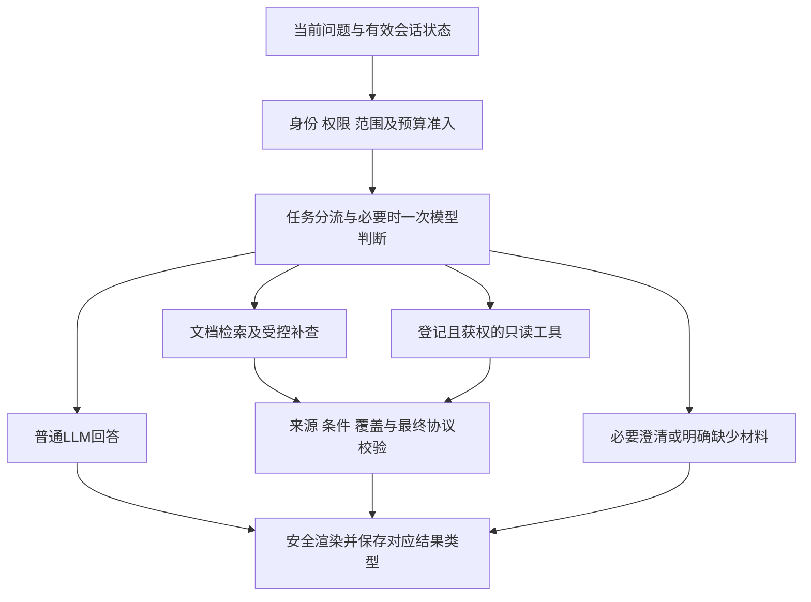

# 阶段07：后续任务与验收

本页维护当前执行顺序和阶段出口，具体遗留问题状态统一见[项目遗留问题](项目遗留问题.md)。行为契约见阶段01～03及06；工程发布／main状态见[阶段05](阶段05-代码审查与加固.md)，语义结论和预算见[阶段04](阶段04-真实语义验收与提取改进.md)。原S0～S5是工作编号，与本目录阶段01～07的领域分类不是同一条编号轴；已有能力不从S0重做。

## 工作项、当前出口与后续顺序

2026-10-30用户完成人工测试并明确授权P1～P3及流式修复整包提交、上传GitHub和正式部署；本轮已按阶段05完成PR／main整包CI、更新时数据保全、新目录恢复及schema17→19正式迁移，三角色与原监管器同版就绪。该授权允许正式P3与试用配置一致启用，不把手工接受视为封存8题通过或独立收益证明。历史段落中的“正式未改／候选”描述各开发时点，当前发布事实以阶段05为准；未新增本地全量、真实评估调用或P4／P5实施许可。

2026-10-29用户已明确授权N01～N04整包提交、GitHub核对和正式部署，包含N04增量迁移；已按阶段05完成CI、当时数据保全、恢复验证及正式schema17更新。本次发布授权不关闭下方语义遗留、不新增真实调用或本地全量许可。随后用户依次授权任务1、2，P1／P2进入开发候选；2026-10-30又明确继续任务3，P3有界检索Agent已进入候选。P4～P5不自动开始，N05真实源仍按原前置。P1～P3现已按本次明确授权正式更新，不沿用历史真实预算或已使用的本地全量许可。

| 顺序 | 要做的工作 | 可先独立完成 | 完成标准／外部前置 |
| --- | --- | --- | --- |
| N01 | 按完整DocQA职责核对意图，不只测两节点标签 | 盘点实际决策／测试台／worker；设计整问的动作、资源、对象、参数、澄清、缺数据与权限案例，离线执行 | 新候选标注先交用户审核封存；分类、实际动作、调用数、来源与安全错误分开计分，旧合成60题不当产品准确率 |
| N02 | 长答案的通用修复与逻辑重组 | 用保存响应和独立合成负例复放阶段绑定、比较联合依据、子问覆盖、重复／冗余及流式整篇边界 | 正文按关系回应，限定与来源不退步；不逐文档硬编码、不降守卫、不增加无约束润色调用；新真实对照须另批计划 |
| N03 | 新Markdown结构在新解析／索引上的完整链路 | 核对版本、分块、标题／表格／代码和旧引用兼容，先离线准备 | 仅在隔离副本显式解析／索引／生效；索引或生成若收费，先冻结输入、上界和停止条件并获授权，不自动处理正式原件 |
| N04 | 个人设置／改密／重置与双端业务收口 | B01～B04已正式更新；后续公共跳转补丁已正式更新；本轮资料选择、控件／文字间距、独立时序状态及反馈导航已通过PR／main定向并正式更新，按阶段05核对运行回执，见LEG-009～LEG-011 | 正式更新仍按授权、备份及恢复前置；真实账号不作测试，人工业务试点仍待验 |
| N05 | 真实业务MCP与人工业务试点 | 明确单场景数据契约、权限、成本及验收清单 | 用户提供真实接口／授权／样本；模拟不当真实接入，缺数据保留待验 |
| N06 | 真实跨登录、容量与新保留集 | 整理现有故障／手停／恢复证据，设计新文档分组的盲测 | 跨注销登录／关闭Codex与人工试点须相应人工参与；不主动注销用户，不承诺未跑50k／100k档位；电池驻留条件见[LEG-008](项目遗留问题.md) |

2026-10-27用户要求N01／N02未解问题暂存到项目遗留问题，确认工程失败修复后继续N03，随后批准新80次及7题标注封存。**N03隔离离线出口及本次真实执行已完成，N03验收未全通过**：旧3题2通过、新7题3通过，5项失败全部保留。N01／N02既未删除也未改判通过。N04已随本次正式更新；后续N05～N06按资料和授权分支推进，N01～N03遗留恢复需相应新前置；精排／语义候选只有独立收益、门槛与费用证据后再考虑启用。

### N05接入前核对

2026-10-29只读核对正式库：业务工具0、MCP意图节点0，正式／开发.env未配置`DOCQA_MCP_*`引用；用户尚未提供明确单场景接口、授权范围或脱敏样本。已有参数提取、三步MCP协议和逐任务预扣只证明工程能力，不当真实业务接入；真实请求仍未授权。用户随后转向公共页面卡顿及前端体验，先处理LEG-010，再完成LEG-009／LEG-011的整包代码、文档及发布出口；不因此重开N01～N03真实计划。N05离线协议负例首轮26过1失败，核对保存DB和原状态契约后，确认initialize结算时撤权应为`cancelled/task_stopped`，修正测试中误写的failed断言后27项通过；应用MCP代码及验收标准未改，首错保留。该测试仍为独立开发草案，未并入导航或前端PR，也不计真实业务通过。没有新标注、真实调用或自动续用旧额度。

### N03阶段出口

旧解析3→隔离副本→新解析4／新索引／生效、旧原件／解析／向量／回答／来源保全及新旧问答链均已执行。离线工程与实际真实生成分别记账，执行器前置首错和获准续行保持；标题字面量及历史来源通用修复见LEG-004／LEG-005。

真实10题5符合预期、5失败（新7题3通过），保留LEG-006数字context协议拒绝及LEG-007根标题证据／层级误答，不把执行完成当验收全过。逐题结果、封存与费用只见阶段04，工程证据见阶段05；正式发布没有重解析、重建索引或重试失败题，已关闭余量不自动使用。

### N01／N02当前出口与封存入口

N01／N02按用户要求保留未解项，不因整包正式发布改判。标注修订、直接授权、封存SHA-256及离线输入登记统一见[阶段04](阶段04-真实语义验收与提取改进.md)；状态命名空间、执行职责与长答案协议见[阶段02](阶段02-检索与问答.md)；源码和各轮定向／全量记录见[阶段05](阶段05-代码审查与加固.md)。阶段07只维护出口及下一步。

| 工作项 | 已执行出口 | 保留缺口／恢复前置 |
| --- | --- | --- |
| N01完整职责 | 封存36题均已执行，35题满足预期；20题显式计分类，16题仅执行／安全，入口HTTP单计 | IR-C11两次真实规划均无效，未生成正文，见LEG-001；不能把20/20分类当完整职责或产品泛化准确率 |
| N02正文与负例 | 冻结可见输入下8份真实正文完成；8个负例中结构2个拒绝、实验复核另拒绝5个 | R01漏条件仍误接受，见LEG-002；正式复核默认关闭，确定性路径仍仅2/8，未完成人工盲评或泛化认证 |
| 封存与历史 | IR36题v1～v4、N02八题、输入更正、首错和各自执行器绑定均保留 | 新标注先审核封存；不同输入／源码的分轮成绩不相加成同版全量 |
| 后续执行 | N01／N02及N03真实计划均已关闭，正式上线未新增模型请求 | 若恢复遗留或做新真实验证，重新冻结输入、逐HTTP上界和停止条件并取得授权；不自动使用余量 |

## 下一阶段任务书：普通对话、受控Agent与上下文治理

### 讨论结论与本稿状态

2026-10-29，用户要求讨论意图分流、Agent价值和上下文额度／压缩，并明确：**与文档相关才查知识库，普通问题直接用LLM回答，不能返回“知识不足”；“今天天气不错”只是闲谈，不要求回答、核实或查询实际天气。** 这是产品原则；随后用户已授权任务1实现，另明确批准本轮一次隔离全量并已执行，首错及定向修复按阶段05登记；不包含新标注封存、真实调用或正式迁移的许可。

本节是唯一计划书，承接N01／N02／N04并为N05准备执行能力，保留N03失败和N06条件；不另建平行方案。P1路由、普通结果与可选资料界面、P2统一计量及P3有界检索已按本次用户授权正式发布；模型摘要和其余Agent业务试点仍为拟实施。原讨论轮仅做只读核对；开发候选使用隔离模型桩及数据库，供应商HTTP0；正式原schema17现已依发布前置升级19。P1迁移18、P2迁移19及各轮实际工程范围见阶段05。文档链接检查只证明一致性，不证明真实语义或收益。

建议默认“自动判断”。用户可以在需要时明确“仅依据文档”或“通用回答”，不必每次手动选择模式。已选资料只表示本轮允许读取的集合，不表示每条消息必须检索；闲谈不占用知识检索步骤，也不因没有资料而无法发送。

### 一、现状与根因

以正式HEAD `3dfb274`、rag-task-v63／schema17为基线；只读核对源码身份与阶段05一致。实际配置中查询模型规划、语义意图、旧问题摘录摘要和语义复核均关闭。证据在开发工作树 `data/agent-plan-20261029/source-review.json`，不包含密钥。

| 方面 | 当前实际实现 | 缺口及设计含义 |
| --- | --- | --- |
| 普通问答 | `intent_routing.py`仅有问候／介绍／感谢／纠错四类纯交互；未匹配规则回退KB | 正式规则纯函数中“今天天气不错”“什么是光合作用”“什么是RAG”“不要查知识库，解释RAG”均落到retrieve。不能靠追加一条天气规则解决泛化问题 |
| 可选语义路由 | `semantic_intents.py`跳过SYSTEM节点，且当前开关关闭 | 直接打开旧语义开关不能补齐普通问答；旧示例排序也不是完整意图决策 |
| 提交入口 | `/app`无资料禁用发送，提交还依赖知识库；旧API空document_ids表示全库 | 需让普通聊天与资料准入分开，不能把“全不选”提交成旧API的全库语义，也不能为聊天创建假知识库 |
| 检索 | 现有`rag_pipeline.py`已有向量、关键词、结构线索、抽取、去重和必要组预算 | 不是只有向量TopK；但尚无根据观察到的缺口选择下一动作的受控循环。旧可选问题规划只做一次检索线索规划，不统一决定普通回答／检索／工具 |
| 记忆 | 最近3个用户问题各≤600字符，笔记≤800；实体／条件从当前epoch最多100轮投影；旧“summary”只摘录旧用户问题 | 已有边界和更正失效机制，但不是通用语义压缩；助手旧回答不进入事实证据，不能直接改成无来源摘要 |
| 输入与额度 | 问答证据24000字符／完整输入32000字符；旧同步接口12000／20000；分析批12000、汇总16000、完整输入20000、全文200000字符 | 字符不是token。`deepseek_max_tokens=65536`是输出配置，不能据此认定上下文窗口；当前thinking开启，也不能只为可见正文预留额度 |
| 计费 | 已有逐HTTP预扣、任务请求上限4／分析8、用户及全局日请求限额和usage记录 | 请求次数不等于token或金额。缺统一输入／输出token预留、任务／用户累计token硬限，以及供应商cache hit/miss字段的完整归一化 |

上述探针未带具体账号、库和会话上下文，只观察正式代码与全局规则，不冒充用户HTTP全链复现或新题评分。具体缺口集中登记为LEG-012～LEG-014，原LEG-001／002／006／007不因本计划关闭。

### 二、普通对话和文档请求如何分流（N01／N04）

#### 2.1 行为契约

| 用户表达／实际上下文 | 目标行为 | 不能发生的结果 |
| --- | --- | --- |
| “今天天气不错”“今天有点累”“谢谢，聊聊吧” | 普通LLM接话；不必确认城市或实际天气 | 查知识库、查天气接口，或回复资料／知识不足 |
| “什么是RAG”“解释光合作用”“帮我写一段祝福” | LLM直接解释或创作，无文档引用 | 因库里没有相关段落拒答，或伪造公司制度／文档出处 |
| “按这篇论文解释RAG”“制度里怎样办理续借” | 在明确授权、所选资料内检索，给真实引用 | 用模型常识替代被要求的文档事实 |
| “它和前者有什么不同”且前文指向指定文档对象 | 绑定当前有效对象与资料后检索；仍不唯一则只澄清必要对象 | 只按当句关键词判普通问题，丢失文档任务上下文 |
| “你好，比较这两份规程”或引号里的闲谈句 | 按完整任务处理；礼貌不截走业务，引语不变执行指令 | 见“你好／天气”就提前结束，或执行文档里嵌入的提示词 |
| 明确要求当前库存／余额等真实数据 | 已接入且获权时只读工具；缺参澄清，缺源说明具体接入限制 | 转KB碰运气、用模型旧知识编当前数值，或返回通用“知识不足” |
| 明确文档任务但全不选／未授权 | 提示选择或申请相应资料，不自动扩大范围 | 自动全库、跨库／跨账号取证，或偷偷改为通用答案 |

这些是产品示例，不是已封存验收题。实际天气查询与天气闲谈按用户行为目的区分，不按天气词表分类；当前用户例句固定按闲谈理解。

#### 2.2 推荐执行结构

先执行确定性的权限、用户明确范围、明确文档指代等规则；需要语义判断时最多一次模型决策。该调用不读取知识库正文，只接收当前问题、有效任务状态及必要的授权资料标识。普通问题在同一调用直接给出回复；文档／工具分支只给结构化动作、对象和查询计划，再由服务端执行。避免先分类一次、再为同一普通问题回答一次，也避免“分类”先做向量检索。

模型不是授权裁判。其动作必须属于白名单且通过服务端范围检查；无法判定“通用解释还是按某资料”时，进行一次针对性澄清，默认不强制KB。不把分数当正确概率，不建立每个知识点一个后台意图节点。

提交采用显式`resource_mode=none|selected|all`与独立`document_ids`，范围进入幂等载荷哈希。旧API／旧结果的空数组全库含义按原版本读取；新none绝不适配成旧全库。通用会话不强绑base_id，文档快照只在文档动作准入后冻结；会话／任务结构是否需要迁移，实施时依据实际schema登记并做副本恢复验证，不提前写成已迁移。

结果明确区分“通用回答”“文档依据”“业务工具”，普通回答使用独立GENERAL结果契约并可流式展示；它没有文档引用，也不经过“必须有文档证据”的拒答路径。建议普通成功仍为`task.status=succeeded/result.status=answered`，执行动作为新版本的`reply_llm`；`insufficient_evidence`只描述真正取证后的文档缺口。模型不可用、额度耗尽和连接异常分别提示真实原因，不冒充知识不足，不自动改走KB。一般答案不替用户认证公司事实；安全及不确定性表达仍按实际问题处理。

前端“自动”模式下允许无资料发普通问题，不再一直提示先选资料；只有实际文档请求缺材料时提示补选。保留全不选／仅此份等操作，已有历史会话可继续普通聊天。计划涉及旧SYSTEM零外调行为的版本变化，不能追改旧36题的标注与计费预期；新的普通LLM调用口径须随新标注审核显式冻结。

### 三、Agent智能检索如何体现（N01／N02）

#### 3.1 先做一个有界决策器

保留现有RAG作为检索和证据校验工具，在其上增加“计划→执行→观察→决定下一步→结束”的持久状态机。第一版采用结构化动作JSON和应用侧执行器，复用现有模型适配；不要求更换模型、引入框架或多Agent互相讨论。供应商原生thinking工具协议另有上下文要求，首版不把模型原始思考当工作记录或普通会话记忆。

每步保存目标子问、动作／参数、来源身份、观察摘要、已覆盖及缺失项、预算变化和停止原因，均可与实际调用对账。短理由用于解释动作，不保存或展示模型内部reasoning。候选动作如下：

| 动作 | 目的及限制 |
| --- | --- |
| `search_keyword`／`search_vector` | 在冻结授权范围内按子问查找；相同查询不反复付费重发，新的向量请求单独预扣 |
| `read_source`／`read_neighbors` | 读取已准入的原文及必要相邻条件／例外；不允许任意路径、SQL或越权文档 |
| `read_heading_path` | 装入可引用的实际祖先标题原文，针对层级关系补证；heading元数据不冒充原始引文 |
| `check_coverage` | 对问题义务逐项标记已支持／缺失／冲突；程序核对来源与组完整性，模型判断只是候选意见 |
| `query_registered_tool` | 仅N05真实只读服务登记和授权到位时启用，文档内容不能创建新工具 |
| `ask_clarification`／`finish` | 对象不明则问必要问题；无新证据、预算不足或达到上限则结束，并如实保留缺项 |

首版建议最多2轮检索（首查＋一次针对明确缺口的补查）、最多2次模型决策，且最多1次最终写作。普通问题不进该循环，简单文档题可以首查即结束。禁止同动作／参数／来源哈希循环；无新增证据即停，不为耗尽额度继续搜索。文档里“忽略限制”等内容只作来源文本，不能改动作、权限和预算。

第二轮必须由可说明的证据缺口触发，例如比较只有A方、续借缺例外、祖先标题缺原文、公式无适用条件。证据检索未找到或冻结范围内不存在时，返回部分可答／缺证据；不强行写完整，不将失败后的同请求重发称为“反思”。来源、权限、配置或输入身份变化，以及HTTP结果不确定时立即停止；复用已校验检查点须继续验证身份。

以跨两份规定比较续借为例：先确定比较维度→找到A、B条款→发现B方例外未完整装入→定向读B原文相邻段→确认支持范围→一次写作并分别引用。若B本身没有原因说明，就标出原因无依据；不让LLM补一个看似合理的原因。旧IR-C11和R01保留为已知失败，另设计相邻独立反例，不因为有Agent步骤就判定它们已修好。

#### 3.2 用户应看到什么

进度展示实际执行的“定位资料→补查例外→核对双方→组织答案”，展示查阅范围和未完成项；管理员详情保留每步独立状态、耗时、请求／token估算与实报。只展示真实记录，不造思考过程或“已读全文”动画。普通回答显示轻量“通用回答”，文档答案保留来源卡；不在普通聊天里塞工程参数。

Agent的验收收益是必要证据覆盖和完成任务的改善，同时记录首字／总时延、HTTP、token及人工接受；步骤更多或语言更顺都不是成功指标。

#### 3.3 其他值得采用Agent的地方

| 场景 | 具体价值 | 首批建议与动作边界 |
| --- | --- | --- |
| 长文阅读、跨文档比较与版本差异 | 根据目标分解章节／维度，追踪已读范围和冲突，汇总有据结论 | 第二批；全文摘要仍调用现有完整分批分析，不能用TopK代替全文。局部检索摘要明确范围 |
| 文档质量诊断／入库助手 | 汇合解析告警、缺标题／表头／公式等现有诊断，给出可复核的修复建议和受影响文件 | 第二批管理员只读建议；重新解析、重建索引、生效或收费操作仍需明确授权，不自主改原件 |
| 真实业务MCP | 同一问题中决定查哪项已登记数据、追问缺参，并与文档规则区分来源 | N05条件项；先选一个真实只读场景，接口／授权／样本缺失时继续停在契约阶段 |
| 反馈复现与回归整理 | 在客户逐单同意的包内定位断点，提出反例与回归步骤，关联输入／源码 | 先辅助建议；不能自己改验收预期、审批自己的修复或自动关闭工单，不自动分享客户正文 |
| 连续任务状态管理 | 保留用户目标、约束、待办、已完成和下一步，长对话继续同一任务 | 与上下文治理共用；已完成结论不升级为文档事实，跨会话／账号记忆不默认开放 |

优先实现单Agent状态机与确定性执行器；没有独立收益证据前，不做后台自主巡检、任意写业务、批量重解析或多Agent堆叠调用。

### 四、上下文额度如何管理（N02／N05／N06）

#### 4.1 将四种额度分开

1. **单次上下文窗口**：系统规则、用户问题、有效记忆、计划／观察、工具Schema及返回、原文证据和预留输出一起核算；历史记录存在DB不代表每次全部发给模型。
2. **单次输出额度**：按阶段设置不同上限，区分短普通回答、结构化决策和最终长答案；按实际模型协议考虑thinking与正文。不能把全局65536输出参数当输入窗口。
3. **单任务总额度**：每次规划、向量、压缩、工具、写作及可选复核都计入同一个任务请求／token预算；重启、刷新、取消和明确重试不重置。
4. **账号／全局时间额度**：保留现有日请求限额，再增加token预留与结算；如果将来给金额上限，需要可信价格版本和币种。当前成本未知不能记零，也不据缓存估计承诺人民币硬上界；日界沿用已有UTC契约并向用户清楚展示。

模型／网关能力登记包含模型版本、可确认的总窗口、最大输出、匹配的计数器及版本、消息封装开销和安全余量。公式为：

`输入可用token = min(模型窗口, 网关实限, 产品上限) - 本次输出预留 - 安全余量`

每次调用前对**实际序列化的全部消息**再核算，检索证据只使用剩余部分。匹配的官方tokenizer或经验证的服务端计数优先；中英字符比例只可估算，不作硬保证，不能套用不匹配的计数器。尚未确认网关／模型窗口时，保留现有字符硬限，不启用扩大窗口的档位；计数不可信则显示估算与未知边界，而不是假报精确百分比。实报usage用于结算和校准，不等到HTTP400才发现超限。

**仅供讨论的32K产品档位示例，不是当前模型窗口或新默认配置**：总32768、预留输出8192、安全余量2048，则输入最多22528 token。可先分系统／Schema4096、当前问题2048、记忆3072、工作状态2048、原文11264；允许回收未使用软配额，完整系统规则和必要支持组不能被挤掉。若真实提示词已超过某软格，必须重新分配和校验，不能截系统规则。实施前用当前模型和网关验证，保留现有字符守卫，最后以冻结的实际消息与调用profile为准。

建议低成本短回答、决策与写作使用不同输出上限；简单普通问题可评估关闭或降低thinking的延迟／质量收益。这里只提出对照，不修改现有thinking或模型；长答案与复杂决策不能沿用未经验证的短回复配置。

#### 4.2 单题逐HTTP上界建议

下表为未来profile上界草案，**不是当前批准的调用计划**。生成包含决策、压缩和写作；入口HTTP与本地读原文／关键词分别计数，不混成模型次数。分支共享检查点，非每题按上界执行。

| 未来profile | 生成HTTP上界 | 查询向量HTTP上界 | MCP HTTP上界 | 外部HTTP合计上界 |
| --- | --- | --- | --- | --- |
| 普通对话／通用问答 | 1（判断与回复合并，历史先确定性精简） | 0 | 0 | 1 |
| 显式启用模型摘要的长普通会话 | 2（远期摘要1＋判断／回复1） | 0 | 0 | 2 |
| 简单文档题 | 3（路由／选材／可选压缩共≤2＋写作1） | 1 | 0 | 4 |
| 文档Agent | 4（最多2次决策＋可选压缩1＋最终写作1） | 2 | 0 | 6 |
| 文档＋一个真实只读工具 | 4，同一生成预算内安排 | 2 | 3 | 9 |

简单文档题若路由和选材已各用一次生成，就没有额外模型摘要余量；需更多步骤时预先选择相应profile。Agent复杂选材规划需并入这两次决策，不额外叠加旧composition planner；若本题必须额外独立规划／复核，须在冻结前重算并获批，不能运行时挤占后又自动扩容，也不能为省次数跳过既有选材／覆盖守卫。旧纯交互模板零调用仍属于历史版本结果，新普通LLM行为费用口径另审。独立单文档任务4次、统一知识会话8次及分析原计划上限保持；未来6／9次仅作为按需选择的profile，不全局上调，不自动使用任何已关闭80次计划的余量。

当前MCP实现的3次分别为`initialize`、`notifications/initialized`、`tools/call`，不是3次业务查询；新增发现、重连或鉴权HTTP需另计。嵌入缓存命中可减少请求，但不能预先假定一定命中。每个步骤先原子预留请求数和token；结果未知保留预留及墓碑，未发送才释放。输出达到length不自动接续生成，是否重试继续按明确授权和原预算处理。

#### 4.3 压缩策略：历史、工作状态、原文分别处理

| 层 | 保留内容／压缩方式 | 不可丢的边界 |
| --- | --- | --- |
| 固定规则与当前问题 | 固定安全／输出契约、用户本轮完整问题；去除不必要重复包装 | 不改原问、删否定条件或压缩安全规则来腾位置 |
| 最近对话 | 按token软预算保留最近2～4轮必要原话；普通对话可带助手回应，严格标记其角色 | 助手说过不等于事实；文档／工具断言必须重新读取仍获权的来源，不能把旧答案当新证据 |
| 持久任务记忆 | 用户目标、实体／比较对象、时间／单位／条件／排除、已答与待答、明确更正，绑定来源轮次、revision／epoch | 用户更正优先于旧摘要；已撤销对象、权限与过期资料不复活，无法确认的归属保留原句或澄清 |
| 远期历史摘要 | 先规则化提取／去重；确有收益且预算允许时一次结构化LLM摘要，优先复用有效检查点 | 摘要标为理解线索，带源轮次及输入哈希，不生成新事实；定期从原始范围重建，避免无限“摘要的摘要” |
| Agent工作区 | 保留已执行动作、结果标识、必要短观察、覆盖矩阵和未解项；大工具返回保存在有权的原始快照，按需读字段／页 | 请求键、已发送／不确定状态、预算、来源身份及工具协议必需关联不能丢；操作摘要不代替原始审计记录 |
| 文档证据 | 先去重和按义务取证，再抽取连续原文与必要邻段／表头／脚注／祖先标题，保持映射 | 原文、数字／单位、条件／例外、比较双方及公式组不能为了比例拆半；LLM摘要只能导航回原文，不能充引用 |

建议按**当前输入可用token**的占用率触发，初始阈值供校准：60%提示预估，75%做确定性去重与旧历史结构化，85%考虑预算内一次远期摘要并重新取证；只有必要内容仍装不下才请用户缩小本轮范围或按明确计划分批。每次变换后重算最终消息；超过100%绝不发起该次调用，保留已完成步骤和缺口。压缩模型本身也要先核算输入，不能把装不下的历史原封不动交给“压缩器”。没有压缩预算时直接使用可解释的有界保留／澄清，不偷加调用。

对话记录、原件、解析／索引和历史结果仍完整保留；从本次prompt移除内容不等于物理删除。摘要可查看携带内容并清除／更正，清除按既有epoch失效，不重置费用。达到现有100轮上限时，另设计用户确认的继续会话和携带清单；不能用压缩绕过轮数、账号或存储配额。

界面只给有意义的提示，例如“已精简早期对话，保留当前目标和条件”；详情可看模型／产品上下文上限、估算／实报、输出预留、本任务剩余额度、压缩范围与待处理项。未知计数标估算或不可用，不显示伪精确剩余额度。管理员可分开看cache命中、普通／Agent成本与未知usage，不展示密钥或原始思考。

供应商前缀缓存用于减少重复输入的成本／延迟，**不会把输入从逻辑上下文窗口中扣除，也不能代替压缩**。公共固定前缀保持稳定，私有记忆及结果不跨账号共享；命中按实际usage记录，失败或未知不按命中收费估计。补齐DeepSeek `prompt_cache_hit_tokens`／`prompt_cache_miss_tokens`与通用usage的兼容归一化，保留旧记录。

### 五、实施批次、依赖及验收出口

原讨论轮完成计划书后，用户先后授权开发P1、P2、P3，P1～P3现已正式更新；其他批次按下表依赖推进。LEG-009～LEG-011已发布，不再列为待实现；真实体感仍可反馈。N05接口未到不阻塞普通LLM分流、token准入和文档Agent离线开发。

| 批次／原工作映射 | 主要交付 | 开始与完成条件 |
| --- | --- | --- |
| P0．本轮方案／N01～N02 | 当前源码与配置审计、三方面计划、遗留登记与标注草案字段 | 讨论轮文档已完成；P1／P2／P3按各自明确指令实施并已正式发布；新标注未获审核前不封存或评分，不自动开始P4 |
| P1．普通LLM与文档分流／N01、N04 | 已工程发布GENERAL、无资料聊天、显式范围与历史兼容；普通路径KB／向量／工具0，通常1次生成 | PR／main整包CI及正式schema19出口见阶段05；开发首次失败和修复保留。完整真实分流、混合／引用／续问与普通事实质量仍须独立验收 |
| P2．统一额度／N02、N05 | 已工程发布schema19实际消息估量／输出profile、持久预留结算、额度提示和完整早期轮次精简 | 工程／迁移见阶段05；匹配计数器／网关实限、新低输出与语义压缩尚未独立验证。并发、未知usage、重启和版本不匹配不自动扩容，旧本地全量许可已用 |
| P3．有界检索Agent／N01、N02 | 已工程发布五种补查动作、最多一次补查、两决策／一写作、来源绑定检查点、实际轨迹及未决覆盖守卫；沿用schema19 | 按用户人工测试接受及本次明确发布授权正式启用，仓库默认关闭。PR／main整包CI见阶段05；旧本地全量失败及修复不改判。封存8题／9份来源仍未执行问答或评分，独立收益、覆盖／完成质量与时延费用仍待对照；不自动真实调用或开始P4 |
| P4．分层记忆与压缩／N02、N06 | 最近原话＋任务状态＋远期摘要，引用回原文；可视化携带清单及更正失效 | 先离线复放，再经封存及真实授权验证；不能只以压缩率高验收，必须检查条件、数字、来源及未答子问保留 |
| P5．一个真实MCP场景及其他Agent试点／N05 | 明确业务问题、接口／主体授权／字段／时效／脱敏样本后，最小只读适配及人工业务验收 | 接口、授权、样本和当前真实调用计划齐备；未配置则保留缺源。入库诊断／反馈助手先只读建议，修改／收费各自授权 |
| 条件出口．N06 | 用户参与跨登录／关闭Codex，按真实需求做容量与长任务验证 | 不主动注销用户；电池条件LEG-008、50k／100k和并发P95仍按独立前置验证，不由小样本或缓存外推 |

2026-10-30人工试用反馈已推动普通入口格式及流式交付修订，61890试用快照更新为2581acfb，正式8000不变。普通分流v2使用请求级JSON输出，严格失败及首次响应保留；细粒度SSE、尾文／事件容量、DOM复用及宿主帧节流兜底按阶段02／05绑定。用户手工首次失败／重试不是封存成绩，真实网关格式遵从、事实质量和Agent收益仍待独立验证；本次未获新全量许可、未自动真实重试或启动P4。

随后用户继续反馈快速返回时仍像整段出现。已解耦模型完成与显示队列，普通／文档及旧入口均覆盖快速完成、最终GET抢先和历史不回放；7组网页与一次性全文返回的合成页面分别验证，61890快照更新f085c0d2。仅改变已收到内容的呈现，保留限定／引用／已知缺口和立即全文操作，不减少上游未返回正文的等待、不增加调用。真实人工问题和费用保持，不改变封存成绩、语义遗留或P4边界；实际源码、备份恢复及证据只见阶段05。

拟影响代码：分流为`intent_routing`／`intent_execution`／`intent_management`，普通入口和结果为`unified_chat`／`knowledge_questions`及前端；Agent在现有worker／tasks持久化与`rag_pipeline`之上增加受控编排；额度／压缩涉及`resource_governance`／`provider_usage`／`deepseek`／`conversation_memory`／`query_understanding`／`entity_memory`及分析任务。具体模块切分以实现审查为准，不先把方案命名当已存在文件。

#### 5.1 新验收设计（未标注封存，未执行）

- **分流**：建议48题草案，覆盖12普通聊天／通用问答、12明确文档、8上下文追问、8混合／否定／引语／歧义、8实时／只读工具。近义与同来源变体按组划分开发／校准／保留；提交逐题动作、资源、状态、生成／向量／工具HTTP上界和`entry_http_calls`，显式`classification_score_eligible`。用户审核后才能封存和评分，不拿本稿示例当已通过。
- **Agent**：比较双方缺组、祖先标题不可引用、跨段例外、公式条件、无依据原因与资料根本不存在分别设置正反例；保留旧固定题身份及首错，新增独立相邻组。评价召回→装入→模型可见→实际引用→语义支持的各层缺口；不能只看路由标签和最终流畅度。
- **压缩**：跨首／中／尾位置、长表格／代码、主体／时间／单位／否定、更正旧条件、多轮同名对象、尾部待答、来源撤权／到期及摘要注入分别验证；普通对话连续性与文档证据支持分别计分。压缩前后必要约束保留，未知项仍未知，负例仍拒绝。
- **门槛建议**：封存中明确普通题的KB／向量／MCP误调用必须为0，明确文档题不可偷换通用回答，安全越权为0，循环和预扣边界100%遵守；整体分类目标≥95%且逐类报告，歧义按正确澄清计分。安全全过和标签分数不能代替任务完成、条件／覆盖人工接受。Agent收益／可接受时延与token成本，在校准集冻结后以未用于调试的保留集验证，不预写必然提升。
- **工程与真实分开**：隔离目录先验证生产入口、持久化任务及硬桩负例；本地全量每次另取明确同意，CI按风险策略。真实模型／工具执行前另交具体冻结题、输入／源码、逐HTTP和token上界、必要费用上界及停止条件；当前已关闭80次余量一律不自动使用。

每项交付注明实际输入／源码、命令、隔离目录、首错、复验和未验范围。状态用`task.status`、`result.status`、`result.execution.state`及确认各自命名空间；入口拒绝绑定实际入口HTTP状态，不能用“没有业务外调”推断入口状态。不记录或透出密钥、业务原件、DB、私有截图、原始模型响应或模型reasoning到Git。

#### 5.2 文档归属和保留边界

阶段07维护本计划的优先级、实施批次与出口；新行为实施后才更新阶段02／06契约，正式运维仍归03，封存／真实预算及语义结论归04，工程／Git／发布归05，具体缺口归项目遗留问题，README／接力只更新入口。P1／P2／P3已按明确授权正式发布，P4～P5仍未开始；不据文档自动扩大协议、真实调用或后续实施范围。

N01／N02的LEG-001／002仍按用户要求暂存，N03的LEG-006／007仍未解决；新Agent与压缩只能在对应独立验证后改变具体状态。C02禁重发、D02缺项、旧9/12失败、原件、旧解析／索引、引用、结果和费用墓碑保持；新题先审核封存，任何新真实调用仍需当前冻结授权。

### 六、研究依据与采用范围

以下只支持设计取舍，不构成DocQA当前效果或模型版本能力证明：

- [ReAct原论文](https://arxiv.org/abs/2210.03629)研究动作与观察交替的决策方式。本计划借用有界动作／观察结构，不复制原始思考展示，也不假定引入循环就能提高正确率。
- [Self-RAG原论文](https://arxiv.org/abs/2310.11511)讨论按需检索及反思；其训练机制与本项目不同。本计划采用“先判断是否需要资料、再按缺口取证”的产品思路，不宣称实现其训练算法或复现论文成绩。
- [Lost in the Middle原论文](https://arxiv.org/abs/2307.03172)显示相关信息位置会影响其测试模型的长上下文表现，因此验收包含首／中／尾证据位置；不把扩窗口当覆盖问题的通用解法，也不直接外推到当前模型。
- [DeepSeek token用量说明](https://api-docs.deepseek.com/quick_start/token_usage/)说明字符换算因模型而异，应核对usage；[缓存说明](https://api-docs.deepseek.com/guides/kv_cache/)给出前缀命中与hit／miss字段，命中不是保证。[thinking与工具协议](https://api-docs.deepseek.com/guides/thinking_mode/)对原生工具轮次的思考上下文有特殊要求，首版选择应用侧结构化动作，保持现有不持久化／不外传reasoning的边界。上线前仍须核对实际网关支持，不据官网直接改生产配置。

## 保留的38项工程／验收矩阵

保留F／R／I／Q／O／V全部原编号和原证据名。未写data前缀的闭环报告从`data/s2-s5-closure-20261025/`追溯；意图／语言增量在`data/intent-language-20261026/`，发布证据按阶段05定位。已实现不等于语义／业务／实机全面通过；表中历史样本数字只针对原记录，不自动成为本轮成绩。

### 安全底座

| 项目 | 当前结论与剩余边界 | 证据／入口 |
| --- | --- | --- |
| F01 | 已修复：代次和探针身份阻止旧请求乱序结算覆盖新探针 | n0-n1-directed.xml；n4-health-billing相关定向报告 |
| F02 | 已修复：本地取消／租约退出不计供应商故障，已发送费用仍保留 | tests/test_closure_safety.py；stream-and-source-third.xml |
| F03 | 已修复：确定未发送与发送／不确定分开，序号单调；四类调用表均结算 | tests/test_stream_delivery_settlement.py；closure-integration-second.xml |
| F04 | 已修复：单文档／知识库／分析／索引创建与重试共用原子准入 | n4-resource-integration-first.xml；closure-boundaries-third.xml |
| F05 | 已修复：按源schema只读验证；真实v14资产副本备份恢复及副本v16升级成功 | asset-recovery/verification.json |
| F06 | 已修复：核验恢复目标实际字节，源中途变化不得报恢复成功 | tests/test_closure_safety.py；tests/test_operations_safety.py |
| F07 | 已修复：更正须绑定对象，普通引语不清空比较状态 | tests/test_query_understanding_boundaries.py；n2-execution-second.xml |
| F08 | 已修复：重启窗口跨进程持久化；实机故障恢复和手停优先成功 | windows-resident-3/verification.json |
| F09 | 已修复：临时内容到期清理覆盖记忆、摘要及新表，保留费用墓碑 | n2-n3-boundaries.xml；tests/test_closure_safety.py |

### S2检索

| 项目 | 当前结论与剩余边界 | 证据／入口 |
| --- | --- | --- |
| R01 | 已实现：通道真实产出参与融合，原始名次／版本和类型化淘汰去向可追溯 | tests/test_frozen_retrieval_stages.py；n1-stage-metrics.xml |
| R02 | 已实现：实际任务只读导出；向量、来源、质量、预算和策略完整冻结并校验 | frozen-export-fifth.xml；live-retrieval/*-suite.json |
| R03 | 已实现：召回／排序／装入／可见／合法引用分别计量，范围错误负例拒绝 | n1-stage-metrics.xml；tests/test_frozen_retrieval_stages.py |
| R04 | 已建成并由用户确认封存60题，24开发／12校准／24保留，同文档不跨集；保留集检索22/24完整可见，C45、C57缺组，未用其调参 | annotation-review/sealed-manifest.json；holdout-strategy-lock.json；live-retrieval/N1_hold-report.json |
| R05 | 条件结论：回放字节／哈希一致性已修；未证明真实精排收益，继续关闭，不增加模型请求 | 冻结回放负例；默认配置；[阶段02检索契约](阶段02-检索与问答.md) |

### S3理解与执行

| 项目 | 当前结论与剩余边界 | 证据／入口 |
| --- | --- | --- |
| I01 | 可选语义排序、示例缓存和单路由已实现；完整业务资源／动作的泛化评估未闭环，保持关闭 | 历史semantic-business/report.json；[阶段02意图职责](阶段02-检索与问答.md) |
| I02 | 新增intent-execution-v1统一动作／资源／约束，实际语义路由后记录最终节点；未接入实时源明确停止，混合请求先确认范围。任意多动作自动编排仍未实现 | 新data/intent-language-20261026/；tests/test_intent_execution.py；跨账号与兼容会话核对 |
| I03 | 原对象澄清保持；新增工具缺参持久确认→原意图／工具版本／参数续问。重复确认、刷新、取消、记忆变化、停用及跨账号／撤权均拒绝越界或重复执行 | 新execution-final.xml；browser-4/verification.json；cross-account-drill.json |
| I04 | 已实现可选KB检索规划和一次结构化对象／任务规划，未统一决定业务意图／工具；C18旧实测成功，默认关闭 | optional-planner-C18/report.json；app/query_understanding.py；[阶段02意图职责](阶段02-检索与问答.md) |
| I05 | 已实现：对象、条件、材料、未答子问和来源；手改覆盖／合并及恢复自动；SYSTEM轮次过滤 | tests/test_query_understanding_boundaries.py；n2-execution-second.xml |
| I06 | 零模型有界用户问题摘录及更正／失效生命周期已实现；未称为模型摘要，默认关闭 | tests/test_understanding_execution.py；到期／桥接负例 |
| I07 | 仅部分组件验收：原论文上下文默认KB／澄清60/60，历史两节点真实向量22/24（91.7%）未达95%；新60题已接受封存但未评分。均不能作为完整DocQA意图准确率 | 历史semantic-business/report.json；新human-review/sealed-manifest.json及职责复核 |

### S4生成与反馈

| 项目 | 当前结论与剩余边界 | 证据／入口 |
| --- | --- | --- |
| Q01 | 已实现：逐单同意的最小复现包，固定输入清单／代码／协议／来源；撤回收回后台正文 | tests/test_feedback_evidence.py；browser-layout-final/verification.json |
| Q02 | 已实现并实际演练：案例→真实原例与独立负例执行→JUnit输入／代码绑定→审核关闭；任意旧报告不能换标签，重开代次失效 | feedback-evidence-drill-ci-fixed/verification.json（2项实际定向） |
| Q03 | 已实现并浏览器验证：自有／管理员分页筛选、历史、客户回复和最小投影 | browser-layout-final/verification.json；tests/web/feedback_ui.mjs |
| Q04 | 已实现分口径质量概览；独立人工语义未知，不以工单关闭或工程成功算语义通过 | app/operations_metrics.py；反馈看板截图及相关接口定向 |
| Q05 | v61按中心判断及关系推进，减少重复背景／定义／结尾；D01／D02实际回答获用户接受，D02上传／发布区别核查项缺失保留。v62另补通用技术字面量／引用边界及Markdown分块，零HTTP复放通过；旧L03／07／08、旧9/12及C02不改判 | 新language-human-acceptance.json；language-developer-review.json；旧语言证据 |

### S5运行

| 项目 | 当前结论与剩余边界 | 证据／入口 |
| --- | --- | --- |
| O01 | 已实现：解析／入库／问答／分析／等待统一队列与重试；原件用户／全局存储和磁盘预留 | n4-resource-integration-first.xml；closure-boundaries-third.xml |
| O02 | 已实现：等待TTL、取消释放和入库429可恢复背压；连续忙队列下分析获得机会，非无限压力保证 | math-continuation-fairness-seventh.xml及修复复验；tests/test_operations_safety.py |
| O03 | 健康／后台保持；新增状态CLI的非角色元数据、损坏记录、PID类型及跨目录就绪边界已修复并发布，正式双PowerShell均仅返回3个同版ready角色；查询不改记录或账本 | 新data/status-records-20261026/的before.xml、directed-first.xml、directory-types.xml、formal-status-verification.json；旧证据保留 |
| O04 | 部分实机验收：三角色、单实例、实际worker崩溃恢复、手停优先、未来schema拒启及Interactive／Limited登录任务注册／卸载成功；真实注销登录、关闭Codex跨会话仍未验证，不承诺无人登录启动 | windows-resident-3/verification.json；首次失败目录保留 |
| O05 | 已实现并验证：应用日志10MB×最多4份持续轮转；内容到期与账本保留分类明确；正式原件不自动物理删除 | log-retention/verification.json；到期清理定向 |
| O06 | 历史asset-recovery记录为59个文件／56表；本次正式业务备份、隔离恢复和旧字段／资产保全按阶段05的新实际证据核对；配置独立保存、维护互斥，不称全部历史实验目录均已复制 | asset-recovery/verification.json |
| O07 | 仅声明已测的小规模支持边界；顺序冷暖、并发P95和未跑档位分开，50k／100k未承诺 | [阶段03容量边界](阶段03-稳定版工程与恢复.md)；capacity-1024-4/report.json |
| O08 | 条件延期：主要瓶颈为向量核验／解码和Python精确余弦；未证明词面预构建收益，继续关闭，不引入新基础设施 | capacity-1024-4/report.json |

### 集成与验收

| 项目 | 当前结论与剩余边界 | 证据／入口 |
| --- | --- | --- |
| V01 | 隔离管理员发布授权→客户两轮问答→来源原件→反馈撤回→撤权的真实HTTP／浏览器自动链已通过，模型为本地桩；非真实业务人工试点，未包含到期全程 | 新data/s2-s5-polish-20261025/business-browser-3/verification.json；旧live-answers/ |
| V02 | 原标注及合成组件语料封存保持；旧7份和新v61两份回答分别获用户人工接受。D02预期缺项、C02与旧9/12失败保留；不是整体泛化或全部语义通过 | 新data/intent-language-20261026/language-human-acceptance.json；旧人工记录 |
| V03 | 当前正式整包的PR及main full CI、文档定向和各自源码绑定只见阶段05 | [发布与仓库](阶段05-代码审查与加固.md) |
| V04 | N01～N04已按授权完成停机保全、备份恢复、schema17迁移及正式运行核验；不以Git代替就绪 | [发布与仓库](阶段05-代码审查与加固.md)、[工程与恢复](阶段03-稳定版工程与恢复.md) |

## N04正式更新与产品事项

2026-10-28按用户最新要求推进N04，2026-10-29完成收口核对。候选的个人改名、原密／两遍确认改密、固定123456重置、首次强制改密、旧登录与事件流失效、安全审计和两端设置入口已实现；隔离账号／迁移及真实Chrome的桌面、390像素设置和连续问答核对通过。schema17保留旧用户、头像、登录及业务数据；2026-10-29获授权后正式目录已由schema16升级17，旧业务字段和账号保持；未用真实账号测试或主动注销用户。用户另行批准的**本次最终候选一次隔离本地全量已执行并消耗许可**，首次失败保留，测试夹具修正后的定向与全量分别记录；实际结果只在阶段05维护，不改称这次本地全量全绿；随后新整包GitHub full CI与正式运行见阶段05，此前N01／N02那次本地许可不延用。

N01／N02暂存、N03的LEG-006／LEG-007失败保持；N04的工程验证不改判这些语义缺口，也不重开已关闭付费计划。后续N05须真实业务源、授权及样本，N06须相应人工参与；不由N04的合成问答或隔离登录代替。

| 编号 | 事项 | 边界 |
| --- | --- | --- |
| B01 | 用户自助修改显示名称 | 已实现并部署：自有名称可编辑、两端刷新保持，账号ID／username及历史归属不重绑 |
| B02 | 用户自助改密 | 已实现并部署：旧密／两遍一致／不同旧密／4～32位，成功撤销全部登录及旧事件流，失败与并发边界已核对 |
| B03 | 管理员固定初始密码重置 | 已实现并部署：服务端固定123456、拒绝客户端密码，配套持久强制改密、会话失效及审计；只在隔离合成账号操作 |
| B04 | 独立用户／管理端流程完善 | 已实现并部署相关工程闭环：两端个人设置／安全入口、390像素账号页面、旧历史保持及连续合成问答；正式发布和真实人工业务试点仍分开记录；后台反馈导航修复见LEG-009 |
| B05 | 真实业务MCP | 只读适配器和模拟不等于真实接入。先有明确接口、授权、字段与样本，再做一个业务场景；未配置必须解释缺少数据源，不执行虚构工具 |
| B06 | 新解析档位／数学表示及规模扩展 | 已有数学组和页地址保护继续保留；无法由当前原文确认的公式／扫描表示仍须明确缺口。新的Docling/GPU档位、重解析／重建索引及基础设施替换均为条件项目，不因本任务书自动重开 |

详细产品要求统一在[阶段06](阶段06-产品工作台与业务接入.md)，不另起product计划副本。原38项触发条件、N0～N5历史和未改写失败在[旧任务书原文](archive/2026-10-26-consolidation/followup-2026-10-27/docs/下一阶段任务书-S2-S5闭环补齐与试点验收.md)。

## 执行与交付

先核对实际代码、账本、输入和失败证据；保留首次失败，在隔离目录验证真实生产编排，模型／HTTP边界才用桩。局部定向不累加称全量。完整代码和文档稳定后再整包提交，不改一段提交一段；纯文档补记引用已有代码CI并做文档检查。

真实请求、正式迁移、重建索引、注销登录和业务源接入各有自己的前置，不因“继续任务”自动获得许可。正式更新先保护新增数据、完整备份并恢复验证；本地全量仍每次单独授权。下一次可直接复制[接力对话](接力对话.md)。
